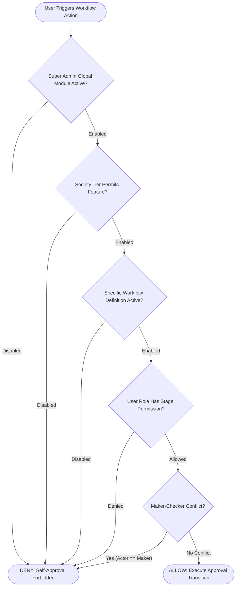

# APPROVAL & WORKFLOW PERMISSION CONTROL MATRIX
**Project:** Multi-Society Cooperative Management SaaS Platform ("স্বপ্ন ছোঁয়া ঐক্য সমিতি")  
**Module:** Phase 3 — Enterprise Approval & Workflow Automation Engine  
**Standards:** Hierarchical RBAC, Super Admin Sovereignty, Zero Historical Data Deletion  
**Date:** 2026-11-14

---

## 1. Permission Hierarchy & Precedence Rules

Access control is evaluated deterministically from highest authority down to the user:



---

## 2. Master Admin Workflow Control Switchboard

| Module / Feature Key | Master Switchboard Key | Permitted Roles | Super Admin Override |
|----------------------|------------------------|-----------------|----------------------|
| **Workflow Engine Master** | `mod_workflow_engine` | All | Global & Society Toggle |
| **Loan Approval Pipeline** | `wf_loan_approval` | Field Officer, Manager, Owner | Multi-Stage Workflow |
| **Savings Withdrawal Approval** | `wf_savings_withdrawal` | Cashier, Manager, Owner | Amount-Based Workflow |
| **Operating Expense Approval** | `wf_expense_approval` | Accountant, Manager, Owner | Threshold-Gated Workflow |
| **Member Registration Approval**| `wf_member_approval` | Field Officer, Admin, Owner | Verification Workflow |
| **Journal & Reversal Approval** | `wf_reversal_approval` | Chief Accountant, Owner | Maker-Checker Mandated |
| **Period Reopening Approval** | `wf_period_reopen` | Super Admin Only | Mandatory Justification |

---

## 3. Granular Button & Action Controls

| Button / UI Action | Master Admin Action Key | Description |
|--------------------|-------------------------|-------------|
| **Submit Request** | `act_wf_submit` | Submits draft request to active workflow queue |
| **Approve Stage** | `act_wf_approve` | Approves current stage and advances pipeline |
| **Reject Request** | `act_wf_reject` | Permanently denies request with reason note |
| **Return for Correction** | `act_wf_return` | Sends request back to maker for amendment |
| **Resubmit Request** | `act_wf_resubmit` | Resubmits amended request back to reviewer |
| **Delegate Authority** | `act_wf_delegate` | Grants temporary approval power to deputy |
| **Cancel Request** | `act_wf_cancel` | Maker cancels request before final approval |
| **Escalate Overdue** | `act_wf_escalate` | Manually or automatically escalates overdue stage |
| **Configure Workflow** | `act_wf_configure` | Create, edit, and deactivate society workflows |

---

## 4. Role Privilege Matrix

```
Action                     SuperAdmin   Owner   Manager   Accountant   FieldOfficer   Member
--------------------------------------------------------------------------------------------
Submit Loan Application        ✓          ✓        ✓          -             ✓           ✓
Verify Member & NID            ✓          ✓        ✓          -             ✓           -
Manager Review Stage           ✓          ✓        ✓          -             -           -
Final Loan Approval            ✓          ✓        -          -             -           -
Authorize Disbursement         ✓          ✓        -          ✓             -           -
Submit Expense Request         ✓          ✓        ✓          ✓             -           -
Approve Expense (< ৳5,000)     ✓          ✓        ✓          -             -           -
Approve Expense (>= ৳5,000)    ✓          ✓        -          -             -           -
Approve Withdrawal             ✓          ✓        ✓          -             -           -
Approve Journal Entry          ✓          ✓        -          ✓             -           -
Approve Period Reopen          ✓          -        -          -             -           -
Delegate Authority             ✓          ✓        ✓          -             -           -
Configure Society Workflows    ✓          ✓        -          -             -           -
```

---

## 5. Inviolable Historical Data Preservation

- **Zero Deletion Guarantee**: When Master Admin or Society Owner disables an approval workflow (e.g., turning off "Loan Approval Pipeline" or "Expense Approval"), **NO HISTORICAL REQUESTS OR APPROVAL LOGS ARE DELETED**.
- All historical approval decisions, reviewer signatures, comments, and audit trails remain permanently stored and viewable in `/somitis/{somitiId}/approval_requests` for legal and regulatory compliance.
