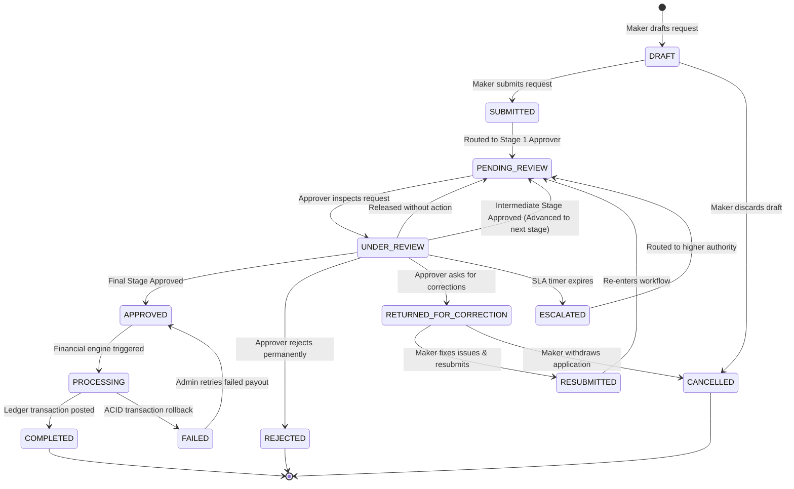

# APPROVAL STATE TRANSITIONS & STATE MACHINE SPECIFICATION
**Project:** Multi-Society Cooperative Management SaaS Platform ("স্বপ্ন ছোঁয়া ঐক্য সমিতি")  
**Module:** Phase 3 — Enterprise Approval & Workflow Automation Engine  
**Standards:** Deterministic Finite State Machine (FSM), Anti-Bypass Guardrails  
**Date:** 2026-11-14

---

## 1. The 13 Enterprise Approval States

```
[1]  DRAFT                    - খসড়া তৈরি (Maker is preparing request)
[2]  SUBMITTED                - দাখিলকৃত (Submitted to workflow queue)
[3]  PENDING_REVIEW           - পর্যালোচনার অপেক্ষায় (Awaiting assigned approver)
[4]  UNDER_REVIEW             - পর্যালোচনায় রয়েছে (Approver opened/locked record)
[5]  APPROVED                 - অনুমোদিত (All required stages signed off)
[6]  REJECTED                 - প্রত্যাখ্যাত (Permanently denied with reasons)
[7]  RETURNED_FOR_CORRECTION  - সংশোধনের জন্য ফেরত (Sent back to maker for missing info)
[8]  RESUBMITTED              - পুনঃদাখিলকৃত (Maker updated and resubmitted)
[9]  ESCALATED                - উচ্চতর স্তরে হস্তান্তরিত (SLA deadline breached)
[10] CANCELLED                - প্রত্যাহারকৃত (Maker cancelled before approval)
[11] PROCESSING               - কার্যকর হচ্ছে (Disbursement/deduction in flight)
[12] COMPLETED                - সম্পন্ন (Financial transaction posted successfully)
[13] FAILED                   - ব্যর্থ (Financial transaction rolled back)
```

---

## 2. Complete State Transition Graph



---

## 3. Strict Transition Enforcement Matrix

| Source State | Permitted Destination States | Authorized Actor Role | Security Validation Guard |
|--------------|------------------------------|-----------------------|---------------------------|
| `DRAFT` | `SUBMITTED`, `CANCELLED` | Maker (Owner / Officer) | Form fields validated, amount > 0 |
| `SUBMITTED` | `PENDING_REVIEW` | System Workflow Engine | Workflow definition active, stage 0 assigned |
| `PENDING_REVIEW` | `UNDER_REVIEW`, `ESCALATED` | Assigned Approver / Cron | Role check matches stage assignment |
| `UNDER_REVIEW` | `APPROVED` (if last stage) | Assigned Approver / Owner | Maker-Checker: `actorUid != makerUid` |
| `UNDER_REVIEW` | `PENDING_REVIEW` (next stage) | Assigned Intermediate Approver | Multi-stage sequential check |
| `UNDER_REVIEW` | `REJECTED` | Assigned Approver / Owner | Mandatory rejection comment required |
| `UNDER_REVIEW` | `RETURNED_FOR_CORRECTION` | Assigned Approver | Mandatory correction instructions required |
| `RETURNED_FOR_CORRECTION` | `RESUBMITTED`, `CANCELLED` | Original Maker Only | Modifications logged in audit trail |
| `RESUBMITTED` | `PENDING_REVIEW` | System Workflow Engine | Re-enters workflow at configured stage |
| `APPROVED` | `PROCESSING` | Financial Service | Payout idempotency key generated |
| `PROCESSING` | `COMPLETED` | Firestore Transaction | Journal entry posted, balances updated |
| `PROCESSING` | `FAILED` | Transaction Rollback Guard | Network error / balance shortfall |

> [!CAUTION]
> **Prohibited Transitions (Auto-Rejected as Security Failures)**:
> 1. `DRAFT` $\rightarrow$ `APPROVED` (Direct jumping bypasses all reviews).
> 2. `REJECTED` $\rightarrow$ `APPROVED` (A rejected loan cannot be resurrected; a new request is required).
> 3. `COMPLETED` $\rightarrow$ `DRAFT` (Completed financial operations are immutable).
