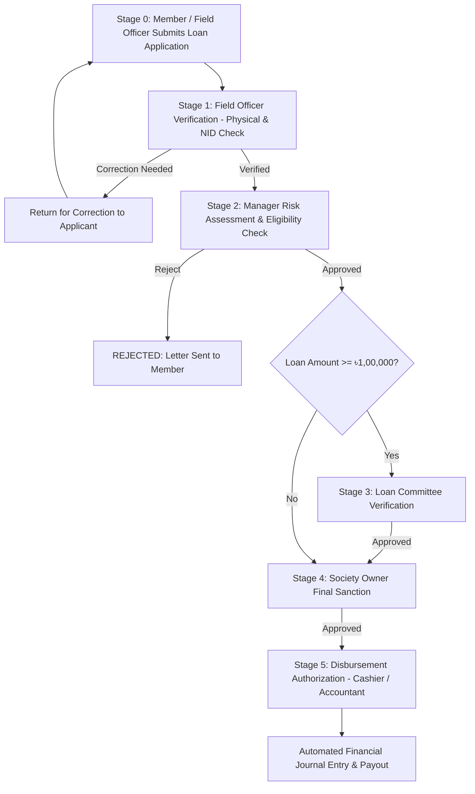

# APPROVAL WORKFLOW DESIGN SPECIFICATION
**Project:** Multi-Society Cooperative Management SaaS Platform ("স্বপ্ন ছোঁয়া ঐক্য সমিতি")  
**Module:** Phase 3 — Enterprise Approval & Workflow Automation Engine  
**Date:** 2026-11-14

---

## 1. Domain-Specific Approval Workflows

### A. Enterprise Loan Approval Pipeline (ঋণ অনুমোদন ও বিতরণ কর্মপ্রবাহ)
*A multi-stage pipeline designed to eliminate bad debts, ghost borrowers, and unauthorized disbursements.*



- **Stages**:
  1. `fo_verification`: Physical residence verification, guarantor signature match.
  2. `manager_assessment`: CIB/history verification, maximum debt ceiling compliance.
  3. `owner_sanction`: Executive sign-off.
  4. `disbursement`: Final release of funds from designated Cash/Bank account.

---

### B. Amount-Based Expense Approval Workflow (ব্যয় ও ভাউচার অনুমোদন)
*Prevents unauthorized cash drainage by enforcing tiered monetary thresholds.*

```
Amount Range               Required Approval Chain
----------------------------------------------------------------------------------
৳১ – ৳৪,৯৯৯                Single-Level: Branch Manager Approval
৳৫,০০০ – ৳৪৯,৯৯৯           Two-Level: Branch Manager + Society Owner Approval
৳৫০,০০০+                   Three-Level: Manager + Chief Accountant + Owner Approval
```

- **Execution**:
  - Accountant drafts expense voucher.
  - System checks `amountInPoisha` and automatically assigns the corresponding workflow definition.
  - The expense amount is NOT debited from Cash in Hand until all required approvals are posted.

---

### C. Savings Withdrawal Approval Workflow (সঞ্চয় আমানত উত্তোলন)
*Protects member funds against unauthorized teller withdrawals.*

1. **Member Initiates Withdrawal Request**:
   - Teller / Member submits request with requested amount.
2. **Automated System Pre-Checks**:
   - Verifies $\text{Requested Amount} \le \text{Current Balance} - \text{Minimum Retained Balance}$.
   - Verifies member has no overdue loans or frozen accounts.
3. **Manager / Owner Sign-Off**:
   - For withdrawals > ৳20,000, requires 2-factor OTP confirmation or Manager digital approval.
4. **Cashier Payout**:
   - Teller disburses cash and prints authorized withdrawal receipt.

---

### D. Financial Reversal & Adjustment Workflow
- **Reversal Trigger**: An accountant identifies an error in a posted journal entry.
- **Workflow Requirement**: Must be approved by Society Owner with mandatory justification.
- **Result**: Upon approval, system automatically creates and posts a reversing journal entry (`REV-XXXXX`) without deleting historical records.
