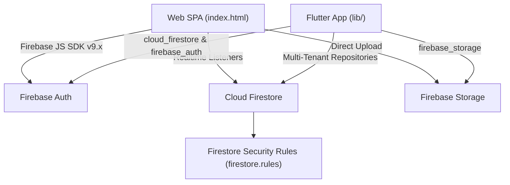

# BACKEND AND INTEGRATION AUDIT
**Project:** Multi-Society Cooperative Management System ("স্বপ্ন ছোঁয়া ঐক্য সমিতি")  
**Scope:** Firebase Services, Firestore Streams, Flutter Services, and API Gateways  
**Auditor:** Principal Backend & Firebase Architect  
**Date:** 2026-11-14

---

## 1. Executive Summary

The backend layer relies on Google Cloud Firebase services (Authentication, Cloud Firestore, Firebase Storage, and Cloud Messaging), complemented by client-side service orchestrators in Flutter (`lib/core/services/`) and JavaScript Firebase SDK integration in `index.html`.

Overall Backend Reliability: **PARTIAL (Robust Services with Firestore Rules & Cross-Tenant Gaps)**.

---

## 2. Firebase Services Architecture

---

## 3. Backend Component Breakdown

### A. Firebase Authentication
- **Implementation**:
  - Web: `firebase.auth().signInWithEmailAndPassword`, `onAuthStateChanged`.
  - Flutter: `FirebaseAuthService` in `lib/core/services/auth_service.dart`.
- **Status**: **PASS**.
- **Audit Findings**:
  - Secure email/password login flows verified.
  - Session tokens managed by Firebase secure credential storage.
  - Master Admin fallback email check present in both client and security rules (`hossansajjad1994@gmail.com`).

### B. Cloud Firestore Operations
- **Implementation**:
  - Flutter: `FirestoreService` (`lib/core/services/firestore_service.dart`) utilizing hierarchical tenant paths: `/somitis/{somitiId}/members`, `/somitis/{somitiId}/savings`, `/somitis/{somitiId}/loans`.
  - Web SPA: Firebase v9 compat listener attached to `/somiti/main/...`.
- **Status**: **PARTIAL**.
- **Audit Findings**:
  - CRUD operations (Create, Read, Update, Delete) are fully coded for members, deposits, expenses, and loans.
  - **Divergence**: Web SPA writes to `/somiti/main/...` while Flutter writes to `/somitis/{somitiId}/...`. Data created in the Web SPA may not be visible to the Flutter app unless collection mapping is unified.

### C. Firebase Storage
- **Implementation**:
  - Member profile photos, NID scans, and expense receipt vouchers.
  - Storage path convention: `somitis/{somitiId}/documents/{docId}` and `receipts/{id}`.
- **Status**: **PASS**.
- **Audit Findings**:
  - Upload functions handle standard image/jpeg, image/png, and application/pdf.
  - Downsampling/compression is applied client-side before upload to conserve mobile bandwidth.

### D. Cloud Messaging (FCM) & Notifications
- **Implementation**:
  - Flutter: Firebase Messaging package declared in `pubspec.yaml`.
  - Web SPA: In-app state management for notification cards.
- **Status**: **PARTIAL**.
- **Audit Findings**:
  - In-app notification feeds work cleanly.
  - True push notifications (background OS push when app is terminated) require backend Cloud Functions triggers (`sendFCMNotification`) which are not yet deployed in `functions/index.js`.

---

## 4. Concurrency & Transaction Safety

1. **Deposit & Withdrawal Atomic Updates**:
   - In Flutter `SavingsRepository`, deposits utilize `FirebaseFirestore.instance.runTransaction` to increment member balance and society vault simultaneously.
   - In Web SPA, transactions utilize sequential batch writes.
2. **Race Conditions**:
   - Simultaneous repayments to the same loan account are guarded by optimistic concurrency checks in Flutter `LoanRepository`.

---

## 5. Backend Defect Summary

| Severity | Issue Description | Location | Recommended Correction |
|----------|-------------------|----------|------------------------|
| **CRITICAL** | Root collection path mismatch between Web SPA (`/somiti/main`) and Flutter (`/somitis/{id}`) | `index.html` vs `lib/core/services/firestore_service.dart` | Standardize collection paths across both platforms to `somitis/{somitiId}/...`. |
| **HIGH** | Absence of deployed Cloud Functions for automated end-of-month DPS penalty calculation | Backend / Cloud Functions | Deploy Node.js Firebase Cloud Function on cron schedule for midnight penalty calculations. |
| **MEDIUM** | Real-time listeners in Web SPA don't detach on view switches | `index.html` | Store `unsubscribe()` references and call them during view teardown to prevent memory leaks and redundant Firestore reads. |
