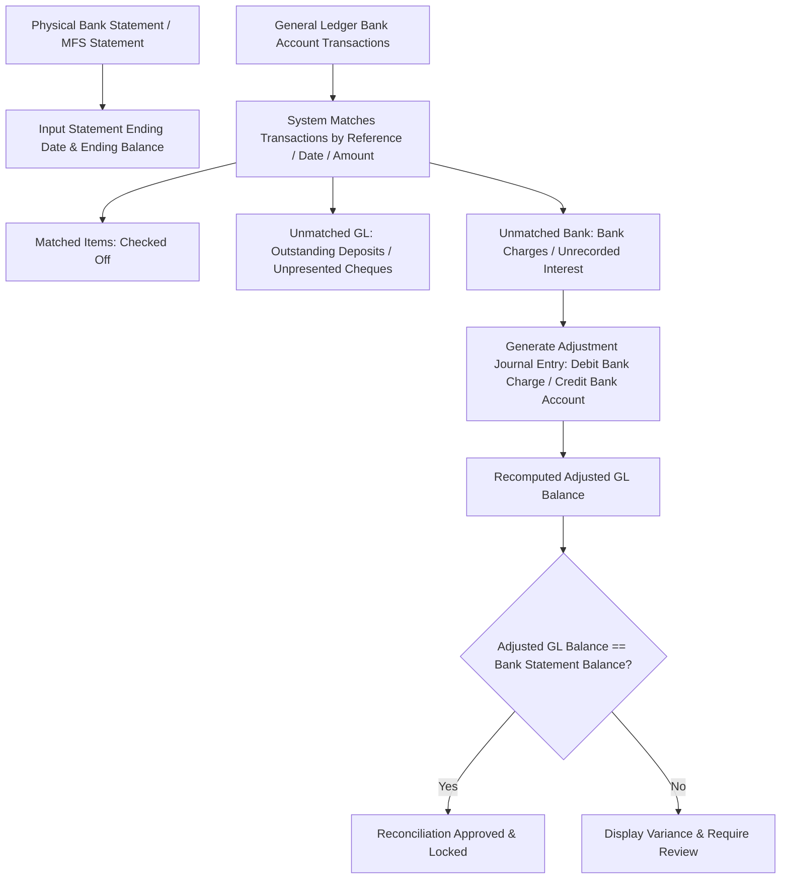

# BANK & MFS RECONCILIATION ENGINE
**Project:** Multi-Society Cooperative Management SaaS Platform ("স্বপ্ন ছোঁয়া ঐক্য সমিতি")  
**Module:** Phase 2 — Advanced Double-Entry Financial Engine  
**Date:** 2026-11-14

---

## 1. Principles of Reconciliation

1. **Zero Silent Modification**: The system NEVER alters, deletes, or overwrites posted accounting transactions during bank reconciliation.
2. **Adjustment Via Journal**: Any discrepancy (such as unrecorded bank fees, excise duty, or credit interest) requires creating a formal **Adjustment Journal Entry** with full audit attribution.
3. **Multi-Account Reconciliation**: Supports commercial banks (City Bank, Sonali Bank) and Mobile Financial Services (bKash, Nagad, Rocket).

---

## 2. Reconciliation Workflow



---

## 3. Data Model (`/somitis/{somitiId}/bank_reconciliations/{reconId}`)

```dart
class BankReconciliationModel {
  final String id;
  final String somitiId;
  final String bankAccountId;        // COA ID of bank account (e.g. 1121)
  final String bankAccountName;      // e.g. "City Bank PLC Current A/C"
  final DateTime statementDate;
  final int statementEndingBalance;  // In Poisha (as per physical bank statement)
  final int glBookBalance;           // In Poisha (as per General Ledger)
  final int outstandingDeposits;     // Collections in transit
  final int unpresentedCheques;      // Payments not yet cleared by bank
  final int adjustedGlBalance;       // glBookBalance + unpresented - outstanding
  final int variance;                // adjustedGlBalance - statementEndingBalance (must be 0)
  final bool isReconciled;           // variance == 0
  final List<String> matchedTxIds;
  final List<String> unmatchedTxIds;
  final String reconciledByUid;
  final String? approvedByUid;
  final DateTime completedAt;
  final String notes;
}
```

---

## 4. Security & Audit Trail

- **Period Lock**: Once a bank reconciliation is approved, transactions in that period cannot be marked unreconciled without Master Admin override.
- **Audit Logging**: Every matched or unmatched action records the operator UID, IP, and timestamp.
