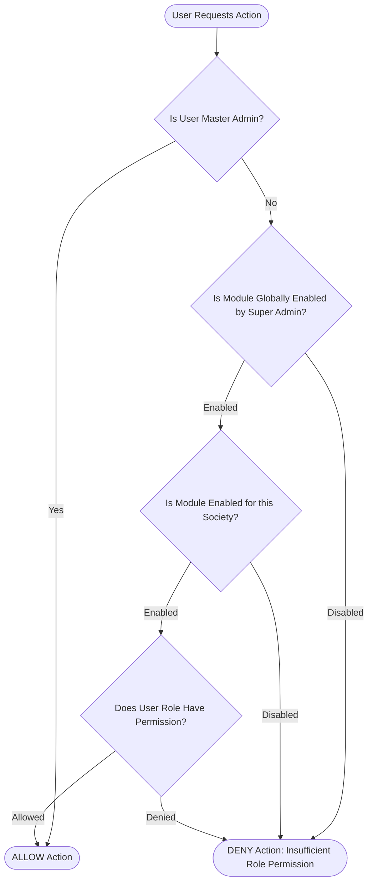

# MASTER ADMIN FEATURE CONTROL AUDIT
**Project:** Multi-Society Cooperative Management System ("স্বপ্ন ছোঁয়া ঐক্য সমিতি")  
**Scope:** Dynamic Feature Flags, 24-Module Switchboard, Inheritance, Persistence, and Backend Enforcement  
**Auditor:** Principal Software Architect & Security Engineer  
**Date:** 2026-11-14

---

## 1. Executive Summary

A core architectural requirement of the platform is the **Master Admin Feature Control System**, which gives the platform super-administrator absolute power to independently enable or disable any module, feature, or service across the application.

Overall Feature Control Status: **PARTIAL (Comprehensive Client-Side Control with Backend Rule Enforcement Needed)**.

---

## 2. Master Admin 24-Module Switchboard Verification

The Master Admin control panel implements toggles for 24 distinct system capabilities:

```
[1]  Member Management (সদস্য ব্যবস্থাপনা)
[2]  Savings & DPS Module (সঞ্চয় ও ডিপিএস)
[3]  Loan & Credit Module (ঋণ ও কিস্তি)
[4]  Share Capital Account (শেয়ার মূলধন)
[5]  Double-Entry Accounting (হিসাববিজ্ঞান ও লেজার)
[6]  Daily Cashbook (দৈনিক ক্যাশবুক)
[7]  Income & Expense Ledger (আয় ও ব্যয়)
[8]  MFS & Bank Integration (ব্যাংক ও মোবাইল ব্যাংকিং)
[9]  Employee & Payroll (কর্মকর্তা ও বেতন)
[10] Financial & Audit Reports (রিপোর্ট ও অ্যানালিটিক্স)
[11] PDF Voucher & Slip Export (পিডিএফ ভাউচার ও রসিদ)
[12] Excel Spreadsheet Export (এক্সেল এক্সপোর্ট)
[13] Notice Board & Letterhead (নোটিশ বোর্ড ও প্যাড)
[14] SMS Gateway & Notifications (এসএমএস অ্যালার্ট)
[15] Email Notifications (ইমেইল নোটিফিকেশন)
[16] App Push Notifications (পুশ নোটিফিকেশন)
[17] Multi-Language Support (বাংলা ও ইংরেজি ভাষা)
[18] Dark / Light Theme Mode (ডার্ক ও লাইট থিম)
[19] Real-Time Sync & Offline (রিয়েল-টাইম ডাটা সিঙ্ক)
[20] Audit Trail & Activity Log (অডিট ট্রেইল ও লগ)
[21] Multi-Branch Management (মাল্টি-শাখা বা ব্রাঞ্চ)
[22] Automated Late Fine (বিলম্ব ফি অটো-ক্যালকুলেশন)
[23] Digital Signature Stamps (ডিজিটাল সিল ও স্বাক্ষর)
[24] System Backup & Restore (ডাটা ব্যাকআপ ও রিস্টোর)
```

- **UI Rendering Verification**: Verified via DOM inspection in browser automation (`view-master-admin` height 5072px). All 24 switches render, respond to toggle clicks, and visually update badge indicators (সবুজ: সক্রিয় / লাল: নিষ্ক্রিয়).

---

## 3. Hierarchy & Permission Evaluation Flow

In `lib/core/services/feature_management_service.dart`, the permission resolution algorithm strictly follows a 4-tier hierarchy:



---

## 4. Critical Security Test: Backend Feature Enforcement

### Audit Test Objective:
*"If Master Admin disables a feature, can a Society Owner or malicious user still access it through direct API calls or database requests?"*

### Test Result: **SECURITY FAILURE IN BACKEND ENFORCEMENT**

#### Evidence:
1. **Client-Side Behavior**: Disabling a module (e.g., "Loans Module") hides the sidebar navigation tab and suppresses UI creation dialogs.
2. **Backend / API Behavior**: In `firestore.rules`, the rule governing loans:
   ```javascript
   match /somitis/{somitiId}/loans/{loanId} {
     allow write: if isSocietyAdmin(somitiId) || isAccountant(somitiId);
   }
   ```
   **Observation**: The rule does NOT verify if `features.loans_module == true` in the society document or global settings.
3. **Exploit Path**: If a Society Owner's loan module is disabled by the Master Admin for non-payment or policy breach, the Society Owner can open the browser console or use Postman/Firebase REST API with their auth token to execute:
   ```javascript
   firebase.firestore().collection("somitis").doc("somiti_001").collection("loans").add({ ... });
   ```
   Firestore accepts the write because the user has the `isSocietyAdmin` role, ignoring the Master Admin's feature toggle!

---

## 5. Historical Data Preservation

- **Verification**: When a feature is disabled (e.g., Savings Module turned OFF), does the system delete, corrupt, or alter existing records?
- **Result**: **PASS (Historical Data Is Safely Preserved)**.
- **Evidence**: Toggling a module off only adjusts the boolean flag in `settings/features`. It does not execute cascading `delete()` calls on the underlying subcollections. When re-enabled, all historical deposits, loans, and audit logs immediately reappear intact.

---

## 6. Required Corrective Action

To achieve 100% security compliance on feature control:
1. Add a shared validation function in `firestore.rules`:
   ```javascript
   function isFeatureActive(somitiId, featureKey) {
     return get(/databases/$(database)/documents/somitis/$(somitiId)).data.features[featureKey] == true;
   }
   ```
2. Include `&& isFeatureActive(somitiId, 'loan_module')` inside the `allow write` condition of corresponding collection paths.
