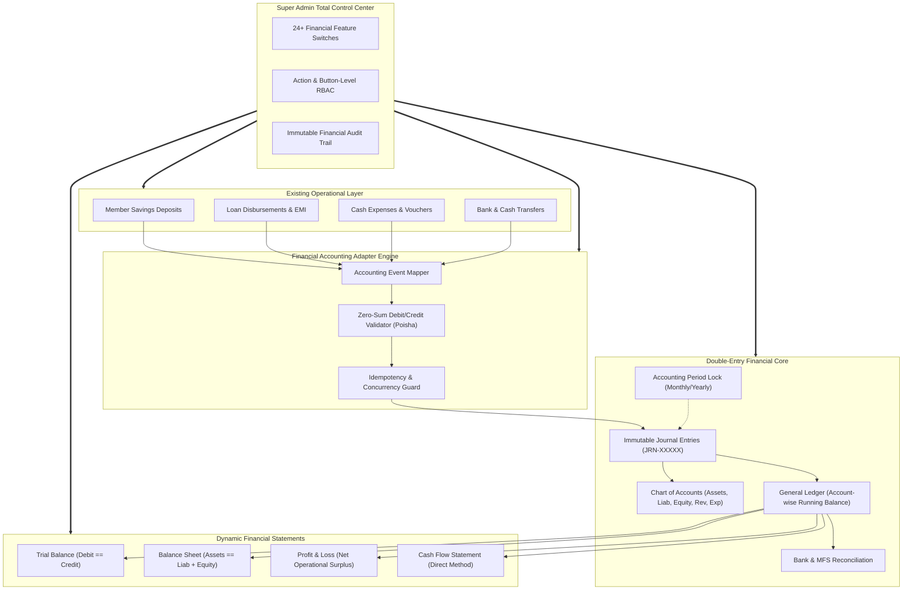

# ENTERPRISE FINANCIAL ACCOUNTING ENGINE ARCHITECTURE
**Project:** Multi-Society Cooperative Management SaaS Platform ("স্বপ্ন ছোঁয়া ঐক্য সমিতি" / `cloud_sync_drive`)  
**Module:** Phase 2 — Complete Financial Engine Architecture  
**Role:** Principal Financial Systems Architect & Enterprise Engineering Lead  
**Date:** 2026-11-14

---

## 1. Architectural System Overview

The **Enterprise Financial Accounting Engine** transforms the cooperative application into a compliant, double-entry financial institution platform.



---

## 2. Master Admin Total Control Matrix

Per Part 1 of the specification, the Master Admin exercises total centralized control over:

### A. Financial Modules (ON/OFF)
1. `mod_financial_accounting`: Master switch for the entire financial engine.
2. `mod_double_entry`: Strict double-entry ledger vs simple cashbook.
3. `mod_chart_of_accounts`: Hierarchical COA access.
4. `mod_general_ledger`: Detailed account-wise ledger.
5. `mod_journal_entries`: Manual and automatic journal voucher creation.
6. `mod_trial_balance`: Live trial balance sheet.
7. `mod_balance_sheet`: Formal balance sheet generator.
8. `mod_profit_and_loss`: Revenue and expense statement.
9. `mod_cash_flow`: Cash flow statement.
10. `mod_bank_reconciliation`: Bank statement matching and reconciliation.
11. `mod_period_closing`: Fiscal month and year closing engine.
12. `mod_adjustments_reversals`: Error correction and reversal journal entries.

### B. Action & Button-Level Permission Matrix
- `btn_create_journal`: Render/block "নতুন জাবেদা তৈরি" button.
- `btn_post_journal`: Render/block "জাবেদা অনুমোদন ও পোস্ট" action.
- `btn_reverse_journal`: Render/block "লেনদেন সংশোধন / রিভার্সাল" button.
- `btn_close_period`: Render/block "হিসাব কাল সমাপ্ত ও লক" action.
- `btn_export_reports`: Render/block PDF/Excel/Print exports.

---

## 3. Database Schema Overview (`/somitis/{somitiId}/...`)

```
/somitis/{somitiId}
  ├── /chart_of_accounts (Documents: code, name, category, normalBalance, balanceInPoisha)
  ├── /journal_entries   (Documents: journalNumber, entryDate, status, totalDebit, lines[])
  ├── /general_ledger    (Documents: accountId, debit, credit, runningBalance, entryDate)
  ├── /accounting_periods(Documents: periodName, startDate, endDate, isLocked, closedBy)
  ├── /bank_reconciliations (Documents: bankAccountId, statementBalance, variance, isReconciled)
  └── /financial_audit_logs (Documents: action, actorUid, timestamp, details)
```

---

## 4. Financial Calculations & Integrity Standards

- **Precision Safety**: All monetary values are strictly represented in **integer minor currency units (Poisha)**.
- **Strict Separation of Funds**:
  - Member DPS & Savings = **Liabilities** (Account `2110`, `2120`).
  - Loan Principal Outstanding = **Assets** (Account `1140`).
  - Interest Income = **Revenue** (Account `4110`).
  - Society Capital & Reserves = **Equity** (Account `3100`, `3200`).
- **Zero-Sum Transaction Guarantee**: $\sum \text{Debit} == \sum \text{Credit}$ enforced at UI, Service, and Security Rules.
