# IMPLEMENTATION DEPENDENCY MAP
**Project:** Multi-Society Cooperative Management System ("স্বপ্ন ছোঁয়া ঐক্য সমিতি" / `cloud_sync_drive`)  
**Role:** Principal Software Architect & Enterprise SaaS Engineering Lead  
**Date:** 2026-11-14

---

## 1. Architectural Dependency Hierarchy

Modern enterprise software requires clean decoupling and explicit dependency chains. New modules cannot be introduced in isolation without respecting the underlying identity, multi-tenancy, and transaction guarantees.

```mermaid
flowchart TD
    %% Core Foundation Tier
    subgraph Tier0 [Tier 0: Core Multi-Tenant Foundation]
        Auth["Firebase Auth & Session Tokens"]
        TenantRules["Firestore Multi-Tenant Security Rules"]
        FeatureFlags["Master Admin 24-Module Switchboard"]
        Subcollections["Subcollections: /somitis/{id}/..."]
    end

    %% Modernization Foundation
    subgraph Tier1 [Tier 1: Cloud & Runtime Modernization]
        CustomClaims["Cryptographic Custom Claims RBAC"]
        PWA["PWA Service Worker & Offline Cache (sw.js)"]
        CloudFunctions["Firebase Cloud Functions Backend (Node 20)"]
        FCM["FCM Push Notification Dispatcher"]
    end

    %% Financial Core
    subgraph Tier2 [Tier 2: Core Financial Ledger & Validation]
        DoubleEntry["Advanced Double-Entry Accounting Engine"]
        MultiApproval["Multi-Level Approval State Machine"]
        AutoCron["Automated Cron & Late Fine Processor"]
        DocManagement["Digital KYC & Document Management"]
    end

    %% Enterprise Advanced Tier
    subgraph Tier3 [Tier 3: Enterprise Automation & Security]
        AutoBackup["Automated Backup & Disaster Recovery"]
        FraudWatch["Fraud Detection & Risk Monitoring"]
        Payroll["Employee HR & Automated Payroll"]
        CustomReports["Custom Report Builder & Query Exporter"]
    end

    %% Enterprise Expansion Tier
    subgraph Tier4 [Tier 4: Ecosystem & Intelligence]
        OpenAPI["Open API & Merchant Payment Webhooks"]
        CRM["CRM & Member Grievance Center"]
        AssetMgmt["Asset & Inventory Register"]
        PredictiveBI["Predictive BI & Default Forecaster"]
    end

    %% Linkages
    Auth --> CustomClaims
    TenantRules --> CustomClaims
    FeatureFlags --> CloudFunctions
    Subcollections --> CloudFunctions

    CustomClaims --> DoubleEntry
    CustomClaims --> MultiApproval
    CloudFunctions --> AutoCron
    CloudFunctions --> FCM
    PWA --> DoubleEntry

    DoubleEntry --> AutoBackup
    DoubleEntry --> Payroll
    DoubleEntry --> AssetMgmt
    MultiApproval --> FraudWatch
    DocManagement --> CRM
    AutoCron --> FraudWatch

    DoubleEntry --> CustomReports
    AutoCron --> CustomReports
    DoubleEntry --> OpenAPI
    FCM --> CRM
    DoubleEntry --> PredictiveBI
    AutoCron --> PredictiveBI
```

---

## 2. Detailed Dependency Breakdown by Feature

### 1. Scheduled Late Fine & Midnight Cron
- **Prerequisites**: `CloudFunctions` (Node.js 20 backend runtime), `Subcollections` (`/somitis/{id}/savings_accounts`).
- **Dependent Features**: `FraudWatch` (detects anomalies in fines), `CustomReports` (delinquent reports).
- **Master Admin Control**: Bound to `automated_late_fine` (Module 22).

---

### 2. PWA Offline Service Worker (`sw.js`)
- **Prerequisites**: Web single-page assets (`index.html`, `/assets/`), IndexedDB Firestore persistence.
- **Dependent Features**: Offline field collection in rural zones, fast app boot.
- **Master Admin Control**: Bound to `offline_sync_module` (Module 19).

---

### 3. Background FCM Push Dispatcher
- **Prerequisites**: `CloudFunctions` project, `device_tokens` collection under members.
- **Dependent Features**: Real-time transaction alerts, `MultiApproval` notifications, `CRM` greeting SMS.
- **Master Admin Control**: Bound to `push_notifications` (Module 16) and `sms_notifications` (Module 14).

---

### 4. Cryptographic Custom Claims RBAC
- **Prerequisites**: Firebase Admin SDK in `CloudFunctions`.
- **Dependent Features**: Eliminates read costs in `firestore.rules`, unlocks secure `MultiApproval` and `OpenAPI`.
- **Master Admin Control**: Bound to `role_management` (Module 4) and `permission_management` (Module 5).

---

### 5. Advanced Double-Entry Accounting
- **Prerequisites**: `CustomClaims` (only authorized accountants can write JVs), `financial_accounts` subcollection.
- **Dependent Features**: `Payroll` (salary debit/credit), `AssetMgmt` (depreciation JVs), `AutoBackup`, `PredictiveBI`.
- **Master Admin Control**: Bound to `double_entry_accounting` (Module 5).

---

### 6. Multi-Level Approval Workflow
- **Prerequisites**: `CustomClaims` (role signatures: Officer $\rightarrow$ Manager $\rightarrow$ President), `loan_applications` subcollection.
- **Dependent Features**: `FraudWatch` (flags approval anomalies), `FCM` (alerts next approver).
- **Master Admin Control**: Bound to `approval_workflows` in Master Admin.

---

### 7. Digital KYC & Document Management
- **Prerequisites**: Firebase Storage bucket, Storage Security Rules (`storage.rules`).
- **Dependent Features**: `CRM`, verified loan approvals.
- **Master Admin Control**: Bound to `document_management` (Module 20).

---

### 8. Automated Backup & Disaster Recovery
- **Prerequisites**: Google Drive API credentials (`googleapis`), `CloudFunctions` scheduled exporter.
- **Dependent Features**: Disaster recovery, tenant data export upon subscription termination.
- **Master Admin Control**: Bound to `backup_restore_module` (Module 24).

---

### 9. Fraud Detection & Risk Monitoring
- **Prerequisites**: `DoubleEntry` ledger history, `MultiApproval` logs, `audit_logs` collection.
- **Dependent Features**: High-risk dashboard KPI widgets, real-time owner alerts.
- **Master Admin Control**: Bound to `audit_trail_module` (Module 20).

---

### 10. Open API & Merchant Webhooks
- **Prerequisites**: `CloudFunctions` HTTP endpoints, `CustomClaims` API scopes, HMAC-SHA256 signature verification.
- **Dependent Features**: Automated bKash/Nagad IPN collection reconciliation.
- **Master Admin Control**: Bound to `payment_gateways` (Module 24).
