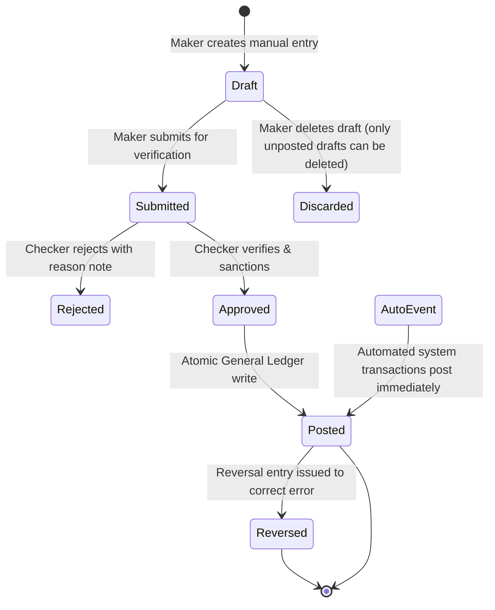

# JOURNAL ENTRY ARCHITECTURE & DATA DESIGN
**Project:** Multi-Society Cooperative Management SaaS Platform ("স্বপ্ন ছোঁয়া ঐক্য সমিতি")  
**Module:** Phase 2 — Advanced Double-Entry Financial Engine  
**Date:** 2026-11-14

---

## 1. Lifecycle State Machine

A Journal Entry moves through a deterministic, auditable state machine:



---

## 2. Document Schema & Data Models

### A. Journal Entry Header (`/somitis/{somitiId}/journal_entries/{journalId}`)

```dart
class JournalEntryModel {
  final String id;
  final String journalNumber;       // e.g. "JRN-202611-00012"
  final String somitiId;
  final DateTime entryDate;
  final String accountingPeriodId;  // e.g. "PERIOD-2026-11"
  final String voucherType;         // "journal", "receipt", "payment", "transfer", "reversal"
  final String description;         // e.g. "নভেম্বর মাসের অফিস ভাড়া পরিশোধ"
  final String? referenceNo;        // Physical cheque no, bank receipt no, or slip ID
  final String? relatedEventId;     // e.g. loanId or depositId if system-generated
  final String idempotencyKey;      // UUIDv4 preventing duplicate submission
  final JournalStatus status;       // draft, submitted, approved, posted, reversed
  final int totalDebitInPoisha;     // Must equal totalCreditInPoisha
  final int totalCreditInPoisha;
  final List<JournalLineModel> lines;
  final String createdByUid;
  final String createdByName;
  final String? approvedByUid;
  final String? approvedByName;
  final DateTime? postedAt;
  final String? reversalOfJournalId;// If this is a reversal entry, points to original
  final String? reversedByJournalId;// If this entry was reversed, points to reversing entry
}
```

### B. Journal Line Breakdown (`JournalLineModel`)

```dart
class JournalLineModel {
  final int lineNumber;            // 1, 2, 3...
  final String accountId;           // Firestore document ID in chart_of_accounts
  final String accountCode;         // e.g. "1110", "2120"
  final String accountName;         // e.g. "প্রধান ক্যাশ ড্রয়ার"
  final AccountCategory category;   // asset, liability, equity, income, expense
  final int debitInPoisha;          // > 0 if debit, 0 if credit
  final int creditInPoisha;         // > 0 if credit, 0 if debit
  final String? memo;               // Optional line-specific note
}
```

---

## 3. Idempotency & Concurrency Safeguards

1. **Idempotency Key Verification**:
   - Each client generation generates `idempotencyKey = uuid.v4()`.
   - Before write execution, the engine checks:
     `db.collection("somitis").doc(somitiId).collection("journal_entries").where("idempotencyKey", "==", key).get()`.
   - If an entry with this idempotency key already exists, the server returns the existing transaction without executing a duplicate write.
2. **Double-Entry Validation Invariant**:
   ```dart
   int sumDebit = lines.fold(0, (sum, l) => sum + l.debitInPoisha);
   int sumCredit = lines.fold(0, (sum, l) => sum + l.creditInPoisha);

   if (sumDebit <= 0 || sumDebit != sumCredit) {
     throw AccountingException("অসম জাবেদা এন্ট্রি বাতিল: মোট ডেবিট (${sumDebit/100}) ও মোট ক্রেডিট (${sumCredit/100}) সমান নয়!");
   }
   ```
