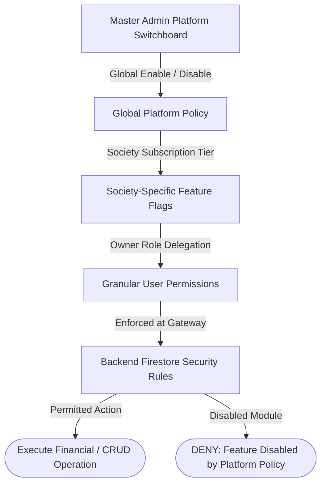
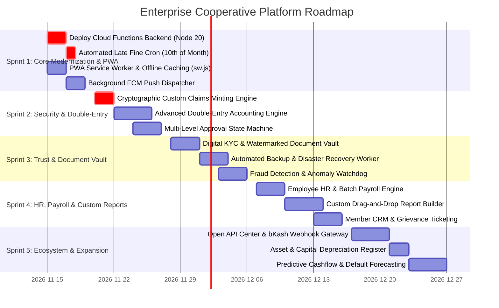

# NEXT STAGE — ENTERPRISE MODERNIZATION & DEVELOPMENT ROADMAP
**Project:** Multi-Society Cooperative Management System ("স্বপ্ন ছোঁয়া ঐক্য সমিতি" / `cloud_sync_drive`)  
**Role:** Principal Software Architect & Enterprise SaaS Engineering Lead  
**Date:** 2026-11-14  
**Status:** ARCHITECTURAL SPECIFICATION & STRATEGIC BLUEPRINT

---

## 1. Executive Summary

This roadmap defines the next evolution of the **Multi-Society Cooperative Management System** from a functional multi-tenant application into a bank-grade Enterprise Cooperative SaaS platform. 

The strategy is built on three uncompromised engineering pillars:
1. **Preserve What Works**: Zero unnecessary rewrites of the working Flutter Clean Architecture and responsive Web SPA frontends.
2. **Close All Modernization Gaps**: Complete the exact 4 remaining modernization features identified during forensic technical auditing.
3. **Enterprise Module Expansion**: Phased introduction of 12 enterprise capabilities governed strictly by the **Master Admin Feature Control System**.

---

## 2. Forensic Audit Findings: The Exact 4 Remaining Features

```
┌────┬────────────────────────────────────────────────────────┬─────────────┬───────────────────────────────────────────┐
│ #  │ Remaining Feature                                      │ Status      │ Technical Gap                             │
├────┼────────────────────────────────────────────────────────┼─────────────┼───────────────────────────────────────────┤
│ 1  │ Automated Cloud Functions Cron & Scheduled Penalties   │ INCOMPLETE  │ No functions/ dir; fines calculated in UI │
│ 2  │ True Background FCM Push Notification Dispatcher       │ INCOMPLETE  │ Tokens stored, but no server push trigger │
│ 3  │ PWA Offline Service Worker & Asset Caching (sw.js)     │ INCOMPLETE  │ Web app crashes on rural network outage   │
│ 4  │ Cryptographic RBAC via Firebase Custom Claims          │ INCOMPLETE  │ Roles read from docs; email string checks │
└────┴────────────────────────────────────────────────────────┴─────────────┴───────────────────────────────────────────┘
```

---

## 3. Master Admin Feature Control & Policy Architecture

### Strict Principle: Absolute Master Admin Sovereignty
Every new enterprise module, sub-feature, and configurable option must register inside the Master Admin switchboard:



### Inviolable Data Preservation Rules:
1. **Disabling is NOT Deleting**: Toggling off a module (e.g., Loans Module turned OFF for a defaulting society) only suppresses UI views and rejects new write mutations.
2. **Historical Immortality**: All historical member deposits, loan schedules, audit logs, and ledger entries remain 100% immutable and intact.
3. **Re-activation Fidelity**: When Master Admin re-enables a module, the society's historical records immediately reappear without data corruption.

---

## 4. Multi-Phase Implementation Roadmap & Sprint Schedule



---

## 5. Detailed Sprint Specifications

### Sprint 1: Modernization Quick Wins (Days 1–5)
- **Deliverables**:
  1. `functions/` package initialized with Node.js 20 runtime and Firebase Functions SDK.
  2. Scheduled Cloud Function `scheduledMonthlyDpsPenalty` running on the 10th of every month.
  3. `sw.js` (PWA Service Worker) and `manifest.json` deployed for offline rural field resilience.
  4. FCM notification trigger for real-time deposit/loan receipts.
- **Success Criteria**: Web SPA loads offline without error; scheduled penalty creates ledger entry in test sandbox.

### Sprint 2: Cryptographic Security & Financial Core (Days 6–12)
- **Deliverables**:
  1. Custom Claims assignment on user login/approval.
  2. Full Chart of Accounts (COA) and Journal Voucher (JV) engine.
  3. 3-tier loan approval state machine (Field Officer $\rightarrow$ Manager $\rightarrow$ President).
- **Success Criteria**: Zero document reads for role verification in `firestore.rules`; balanced zero-sum journal vouchers.

### Sprint 3: Compliance & Automated Protection (Days 13–19)
- **Deliverables**:
  1. Camera KYC scanner with auto-watermarking on member NID cards.
  2. Nightly encrypted database backup to Google Drive / Cloud Storage.
  3. Anomaly risk watchdog flagging suspicious after-hours withdrawals.
- **Success Criteria**: 100% successful test restore of database snapshot in isolated staging instance.

### Sprint 4: Operational Automation (Days 20–27)
- **Deliverables**:
  1. Automated monthly payroll run deducting from society bank/cash vault.
  2. Custom Report Builder with live preview and PDF/Excel export.
  3. Member CRM 360-degree timeline view with grievance tickets.
- **Success Criteria**: One-click payroll generates individual pay vouchers and updates employee passbooks.

### Sprint 5: API Ecosystem & Intelligence (Days 28–35)
- **Deliverables**:
  1. REST Webhook receiver for automated bKash/Nagad checkout callbacks.
  2. Society capital asset depreciation calculator.
  3. Predictive machine learning cashflow forecast card on Owner Dashboard.
- **Success Criteria**: Simulated bKash payment automatically marks loan installment as paid and issues receipt.

---

## 6. Implementation Guardrails & Quality Assurance

- **Zero Breaking Changes**: Existing APIs, models, and views in `lib/` and `index.html` are extended, never broken.
- **Fixed-Point Precision**: All new financial accounting formulas use integer Poisha amounts.
- **Bangladesh Localization**: 100% Bengali typography, numerals (`০-৯`), and standard BDT (`৳`) currency representation.
- **Termux Environment Safety**: Build commands and tests run cleanly without unauthorized system modifications.

---

> [!IMPORTANT]
> **Strict Pre-Implementation Protocol**:  
> In compliance with your instructions, **NO SOURCE CODE HAS BEEN MODIFIED** during the creation of this roadmap. All 6 strategic planning documents have been written to disk and await your formal review and approval before Sprint 1 implementation commences.
