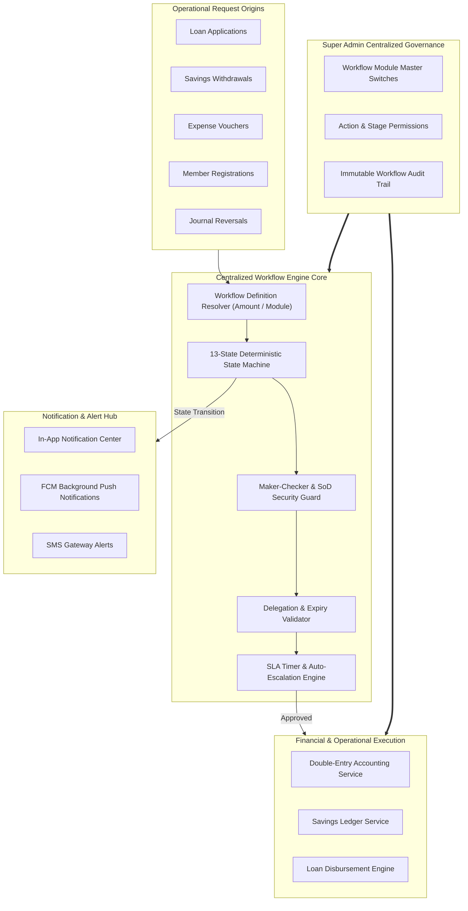

# WORKFLOW ENGINE ARCHITECTURE MASTER SPECIFICATION
**Project:** Multi-Society Cooperative Management SaaS Platform ("স্বপ্ন ছোঁয়া ঐক্য সমিতি")  
**Module:** Phase 3 — Enterprise Approval & Workflow Automation Engine  
**Role:** Principal Enterprise Software Architect & Workflow Systems Lead  
**Date:** 2026-11-14

---

## 1. Executive Architectural Blueprint

The **Enterprise Workflow Automation Engine** provides a database-driven, multi-tenant approval fabric governing all operational and financial mutations across the platform.



---

## 2. Dynamic Workflow Definition & Amount Threshold Engine

Instead of hardcoding approvals in individual modules, the engine resolves workflows dynamically:

```dart
WorkflowDefinitionModel resolveWorkflow({
  required String somitiId,
  required String moduleKey,
  required int amountInPoisha,
}) {
  // 1. Fetch active workflows for this module
  // 2. Filter by monetary range: minAmount <= amount <= maxAmount
  // 3. Select matching configured workflow or fallback to default single-stage workflow
}
```

---

## 3. Financial Integration & Transaction Atomicity

- **No Premature Financial Deductions**:
  Submitting an expense or savings withdrawal request does NOT decrement physical cash or member balances.
- **Atomic Payout Commit**:
  Once a request reaches `APPROVED`, the financial service triggers an atomic transaction:
  1. Verifies current stage is `APPROVED` and unexecuted (`status != 'COMPLETED'`).
  2. Sets status to `PROCESSING`.
  3. Executes double-entry journal entry and ledger deductions inside `FirebaseFirestore.instance.runTransaction`.
  4. Sets status to `COMPLETED` with generated `voucherNo` and `journalId`.
  5. If an error occurs, status transitions to `FAILED` with error note for administrative review.

---

## 4. Multi-Role Dashboard Specifications

1. **Platform Super Admin**:
   - Total workflows across all societies.
   - Global module and button-level permission switches.
   - Cross-society workflow performance and audit log monitor.
2. **Society Owner**:
   - Society pending approval queue with 1-click batch review.
   - Financial authorization dashboard for expenses >= ৳5,000 and loans >= ৳50,000.
3. **Manager**:
   - Active inspection queue (Field Officer verification reports, member eligibility checks).
   - Approval deadlines and approaching SLA alerts.
4. **Accountant**:
   - Financial approval inbox for expense vouchers, journal entries, and bank reconciliation.
5. **Field Officer**:
   - Submitted applications tracker with return-for-correction notices.
6. **Member**:
   - Transparent application status tracker with real-time push alerts.
