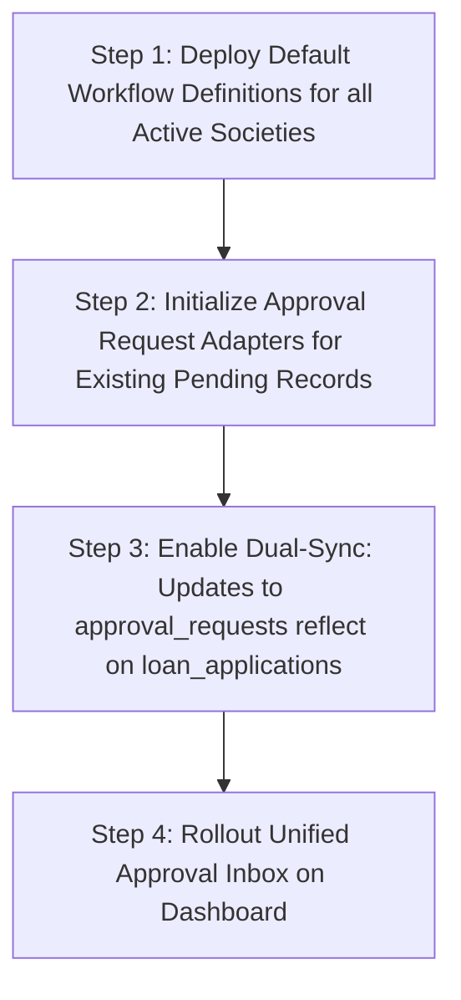

# WORKFLOW MIGRATION & BACKWARD COMPATIBILITY PLAN
**Project:** Multi-Society Cooperative Management SaaS Platform ("স্বপ্ন ছোঁয়া ঐক্য সমিতি")  
**Module:** Phase 3 — Enterprise Approval & Workflow Automation Engine  
**Standards:** Zero Downtime, Zero Data Loss, Backward Compatibility  
**Date:** 2026-11-14

---

## 1. Forensic Audit of Existing Pending Records

An inspection of current society collections identifies two existing sources of pending requests:
1. **Loan Applications (`/somitis/{somitiId}/loan_applications`)**:
   - Statuses currently stored: `'pending'`, `'approved'`, `'rejected'`.
2. **User Sign-up Requests (`/user_requests`)**:
   - Statuses currently stored: `'pending'`, `'assigned'`, `'rejected'`.
3. **Expenses (`/somitis/{somitiId}/expenses`)**:
   - Currently posted immediately without an approval queue.

---

## 2. Safe 3-Step Migration Strategy

---

## 3. Seed Default Workflow Templates

For every existing society, the engine automatically initializes standard default workflows:

1. **Standard Loan Approval Workflow (`wf_loan_default`)**:
   - Stage 1: Field Officer Verification (`field_officer`)
   - Stage 2: Manager Review (`manager`)
   - Stage 3: Society Owner Final Approval (`owner`)
2. **Standard Expense Approval Workflow (`wf_expense_default`)**:
   - Stage 1: Manager Approval (for expenses < ৳5,000)
   - Stage 2: Society Owner Approval (for expenses >= ৳5,000)
3. **Member Registration Workflow (`wf_member_default`)**:
   - Stage 1: Admin / Manager Verification (`admin`, `manager`)

---

## 4. Dual-Sync Compatibility Layer

To prevent breaking existing screens (e.g. `view-loans`, `lib/features/loans/`):
- When an approval request is approved or rejected in the new Workflow Engine:
  1. The new record is updated in `/somitis/{somitiId}/approval_requests/{id}`.
  2. The legacy document in `/somitis/{somitiId}/loan_applications/{appId}` is simultaneously updated with `status: 'approved'` and reviewer name.
- Existing screens continue functioning with 100% fidelity.

---

## 5. Rollback & Failsafe Plan

- If any unexpected error occurs, setting `features.workflow_engine = false` in the Super Admin switchboard safely falls back to standard single-level approvals.
- No existing records are deleted or modified destructively.
