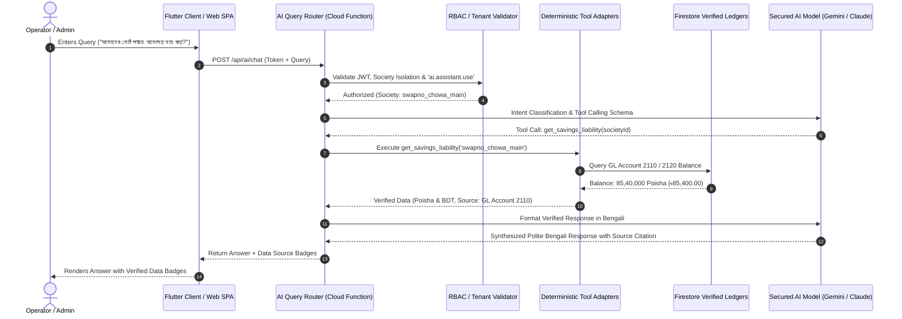

# ENTERPRISE AI ASSISTANT SPECIFICATION

## 1. Overview
The Centralized AI Assistant provides a multilingual (Bangla, English, and Banglish) conversational interface for authorized society operators, accountants, managers, and platform administrators. It executes natural language queries against verified database records through strictly bounded tool endpoints.

## 2. Supported Natural Language Capabilities
- **Member Inquiries**:
  - *"আমাদের বর্তমান সক্রিয় সদস্য কতজন এবং কতজনের KYC বাকি?"*
  - Retrieves active vs inactive member counts and unverified KYC records.
- **Financial & Ledger Queries**:
  - *"এই মাসের মোট কালেকশন কত হয়েছে এবং খরচের হিসাব কী?"*
  - Aggregates verified payment transactions and posted expense vouchers.
  - Distinguishes **Savings Deposits (Liability: 2110)** from **Income (Revenue: 4110/4210)**.
- **Loan Portfolio & Overdue Tracking**:
  - *"কোন কোন সদস্যের কিস্তি খেলাপি হয়েছে এবং মোট বকেয়া আসল কত?"*
  - Computes overdue loan principal receivables (`Account 1141`) and installment aging.
- **Operations & Stock Insights**:
  - *"কোন কোন ইনভেন্টরি আইটেমের স্টক রিঅর্ডার লেভেলের নিচে নেমে গেছে?"*
  - Queries Phase 6 stock items with `currentStock <= reorderLevel`.

## 3. Data Flow & Security Guardrails

## 4. Response Reliability Standards
1. **Source Citation**: Every response containing figures must cite the underlying ledger or document (e.g., `উৎস: সাধারণ খতিয়ান হিসাব ২১১০, তারিখ: ১৪ নভেম্বর ২০২৬`).
2. **Missing Data Handling**: If historical data is missing or incomplete, the assistant outputs:
   - *"দুঃখিত, প্রয়োজনীয় ডেটা অপর্যাপ্ত বা যাচাই করা সম্ভব হয়নি।"*
3. **No Direct Execution**: The assistant will explain how to disburse a loan or post a journal, but cannot execute write transactions without triggering the Phase 3 Workflow Maker-Checker process.
