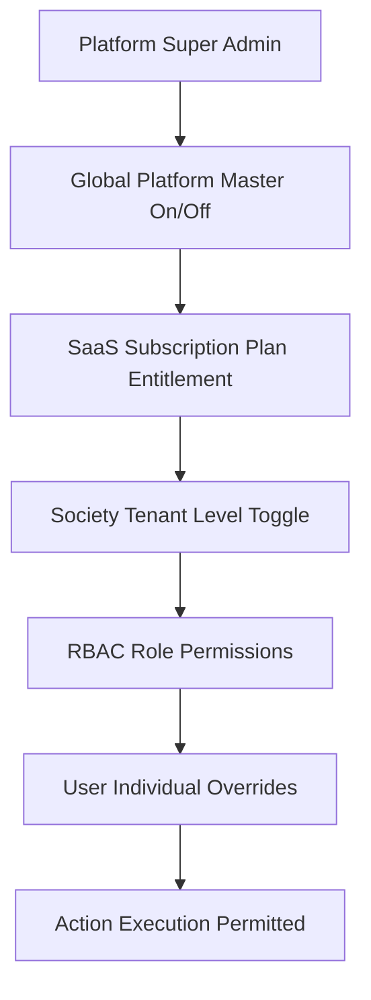

# SUPER ADMIN UNIVERSAL AI & ANALYTICS PERMISSION CONTROL

## 1. Governance Architecture
Super Admin / Master Admin maintains centralized, immutable control over every AI capability, analytics dashboard, widget, and background automation across all tenant societies.

## 2. Phase 8 Granular Permission Registry
The following 10 permissions are registered in `lib/models/security_compliance_model.dart`:

| Permission Key | Bengali Title | Scope & Description | Default Roles |
| :--- | :--- | :--- | :--- |
| `ai.dashboard.view` | এআই ড্যাশবোর্ড ও চ্যাট পর্যবেক্ষণ | Access to the AI & Analytics Hub view | Admin, Manager, Super Admin |
| `ai.assistant.use` | এআই অ্যাসিস্ট্যান্ট চ্যাট ব্যবহার | Send natural language queries to AI assistant | Admin, Manager, Cashier |
| `ai.assistant.configure` | এআই অ্যাসিস্ট্যান্ট কনফিগারেশন | Modify prompt templates and tool bindings | Super Admin only |
| `ai.search.use` | এআই চালিত স্মার্ট ও ডকুমেন্ট সার্চ | Natural language semantic search across records | Admin, Manager, Accountant |
| `ai.reports.generate` | এআই চালিত স্বয়ংক্রিয় রিপোর্ট ও সারাংশ | Generate executive summaries and automated insights | Admin, Super Admin |
| `analytics.dashboard.view` | উন্নত আর্থিক ও প্রাতিষ্ঠানিক অ্যানালিটিক্স দেখা | Access financial KPIs, graphs, and ratio dashboards | Admin, Accountant, Super Admin |
| `analytics.predictions.view` | ভবিষ্যদ্বাণী ও আর্থিক পূর্বাভাস দেখা | View cash flow, savings, and loan default forecasts | Admin, Super Admin |
| `risk.fraud_alerts.manage` | প্রতারণা ও অসঙ্গতি (Anomaly) অ্যালার্ট ব্যবস্থাপনা | Review, investigate, and resolve fraud alerts | Admin, Auditor, Super Admin |
| `reports.custom.builder` | কাস্টম রিপোর্ট বিল্ডার ও এক্সপোর্ট | Design dynamic custom reports and export to PDF/CSV | Admin, Accountant, Super Admin |
| `ai.providers.manage` | এআই মডেল ও প্রোভাইডার সেটিংস কন্ট্রোল | Enable/disable AI providers, set quotas and models | Super Admin only |

## 3. Mandatory Security Rule
A lower-level permission can **never** override a higher-level restriction:
1. If `isGlobalAiEnabled == false`, no society or user can call AI, regardless of role.
2. If `society.isAiEnabled == false`, no user within that society can access AI features.
3. If the active subscription plan does not include the AI module, access is denied.
