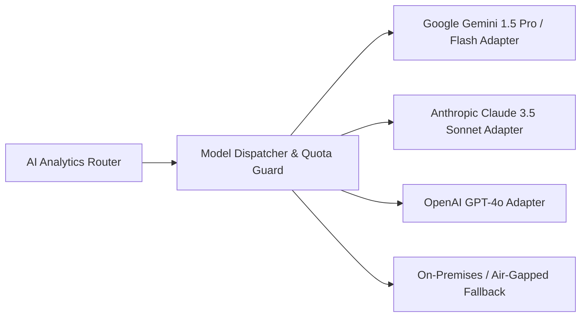

# AI PROVIDER INTEGRATION & MODEL MANAGEMENT

## 1. Provider-Agnostic Adapter Pattern
The AI engine implements a provider-agnostic abstraction layer allowing seamless routing, fallback, and Super Admin control between leading foundation models.

## 2. Supported AI Providers & Models
| Provider ID | Provider Name | Default Model ID | Strengths / Use Cases | Quota Limits (Req/Min) |
| :--- | :--- | :--- | :--- | :--- |
| `provider_gemini` | Google AI Cloud | `gemini-1.5-flash` | Ultra-fast natural language queries, document intelligence, Bangla syntax | 120 req/min |
| `provider_gemini_pro` | Google AI Cloud | `gemini-1.5-pro` | Complex financial reasoning, multi-period audit analysis | 60 req/min |
| `provider_claude` | Anthropic | `claude-3-5-sonnet` | Precise structured output extraction, complex tabular report summarization | 50 req/min |
| `provider_openai` | OpenAI Azure | `gpt-4o` | Secondary failover for natural language conversational assistant | 80 req/min |

## 3. Super Admin Centralized Provider Switchboard
Super Admin retains exclusive control over:
1. **Global Provider Toggle**: Instantly activate or deactivate any provider platform-wide.
2. **Society-Level Model Assignment**: Assign lighter models (`gemini-1.5-flash`) to Starter plans and reasoning models (`gemini-1.5-pro`) to Enterprise plans.
3. **Fallback & Circuit Breakers**:
   - If primary provider latency exceeds $2,500\text{ ms}$ or returns HTTP $5xx$, the engine automatically switches to secondary fallback without disrupting user workflow.
4. **Credential Isolation**:
   - Keys are loaded via Cloud Functions from Secret Manager (`projects/${PROJECT_ID}/secrets/GEMINI_API_KEY/versions/latest`). No API keys exist in client-side code.
