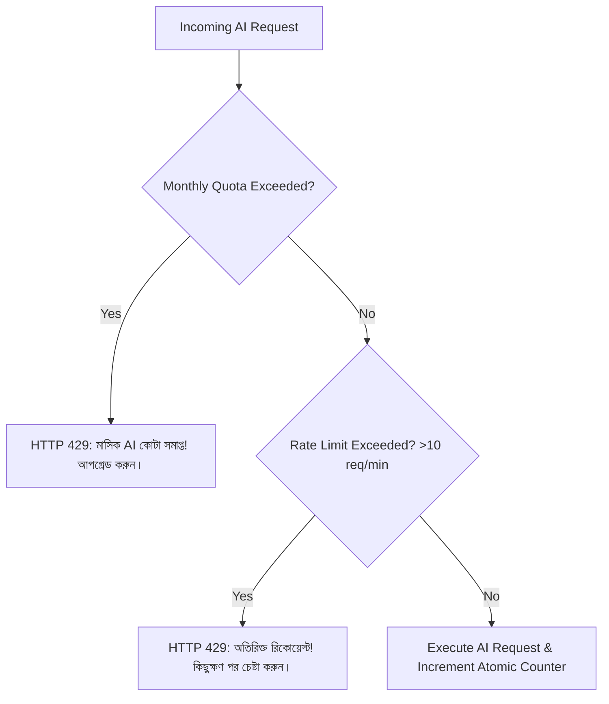

# AI USAGE, TOKEN METRICS & COST GOVERNANCE

## 1. Tracking Model
To protect platform operators from unexpected foundation model API costs and denial-of-wallet attacks, the platform tracks:
- Total Prompt Tokens
- Total Completion Tokens
- Request Count
- Latency (ms)
- Estimated Provider Cost ($/BDT)
- Society & User Usage Breakdown

## 2. Quota & Rate Limit Engine
Each tenant society is bounded by monthly request limits based on its active SaaS subscription tier:
- **Starter Plan**: 250 AI requests/month (Gemini 1.5 Flash only).
- **Professional Plan**: 1,500 AI requests/month.
- **Enterprise Plan**: 10,000 AI requests/month + custom dedicated Gemini Pro models.

## 3. Atomic Quota Enforcement in Firestore
Counters are stored at `/somitis/{somitiId}/ai_usage/{currentYearMonth}` and updated using Firestore `FieldValue.increment()` to prevent race conditions during concurrent queries.
