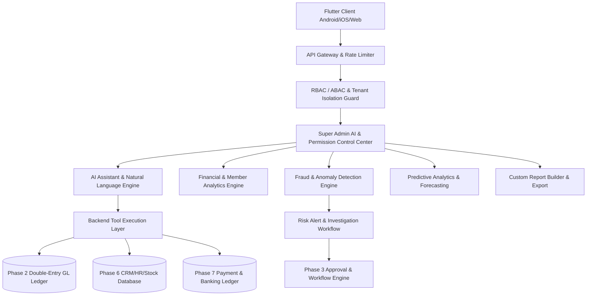

# PHASE 8 — ENTERPRISE AI, ADVANCED ANALYTICS & BUSINESS INTELLIGENCE ENGINE

## 1. Executive Summary & Architectural Overview
Phase 8 transforms the **Multi-Society Cooperative SaaS Platform ("স্বপ্ন ছোঁয়া ঐক্য সমিতি")** into an intelligent, data-driven financial ecosystem. The architecture integrates an enterprise AI Assistant, automated Business Intelligence (BI), predictive forecasting, fraud & anomaly detection, and a custom report builder while maintaining strict multi-tenant isolation, Zero Floating-Point Float Drift (integer Poisha math), and comprehensive Super Admin centralized governance.

## 2. Core Architectural Principles
1. **Zero Secret Exposure on Client**:
   - All AI provider credentials (`GEMINI_API_KEY`, `OPENAI_API_KEY`, `CLAUDE_API_KEY`) reside exclusively in Google Cloud Secret Manager / Cloud Functions.
2. **Server-Authoritative Data Retrieval**:
   - The LLM is never given direct, unrestricted Firestore SDK access. Queries are mediated via registered, deterministic backend tool adapters that strictly enforce tenant and role isolation.
3. **Mandatory Human-in-the-Loop for Financial & Admin Operations**:
   - AI generates recommendations, draft summaries, and risk alerts, but **never** directly approves loans, disburses cash, posts financial journals, or freezes member accounts without authorized human maker-checker approval.
4. **Integer Poisha Precision**:
   - All financial amounts in analytics and predictions use integer Poisha ($1\text{ BDT} = 100\text{ Poisha}$) to preserve reconciliation with the Phase 2 General Ledger (`Account 1110`, `1121`, `2110`, `1141`, `4110`).
5. **Multi-Tenant Data Privacy Boundary**:
   - Cross-society data leakage is physically impossible. Society data queries mandate `request.auth != null && resource.data.societyId == requestingUser.societyId`.

## 3. Subsystem Breakdown
| Subsystem | Primary Function | Primary Source Collection |
| :--- | :--- | :--- |
| **AI Assistant** | Natural language queries in Bengali/English with verified backend retrieval | `somitis/{id}/ai_conversations` |
| **Financial Analytics** | Ledger-based KPIs, cash flow, overdue aging, liquidity ratios | `somitis/{id}/general_ledger`, `chart_of_accounts` |
| **Member Analytics** | Retention, active savers/borrowers segmentation, KYC conversion | `somitis/{id}/members`, `kyc_records` |
| **Loan & Risk Engine** | Delinquency tracking, PAR (Portfolio at Risk 30/60/90), concentration | `somitis/{id}/loans`, `loan_repayments` |
| **Anomaly Detection** | Suspicious transaction frequency, duplicate attempts, stock leaks | `somitis/{id}/risk_alerts` |
| **Predictive Engine** | Holt-Winters / Linear Trend models for cash flow, savings, and churn | `somitis/{id}/forecast_runs` |
| **Custom Report Builder** | Dynamic field selection, aggregations, PDF/CSV export guards | `somitis/{id}/custom_reports` |
| **Provider Switchboard** | Super Admin model enable/disable, latency & quota monitoring | `platform_configs/ai_providers` |

## 4. Super Admin Universal Permission Integration
Every AI and analytics feature is registered with an immutable permission key in `lib/models/security_compliance_model.dart` and dynamically evaluated against society feature flags in `lib/models/feature_flag_model.dart`.
