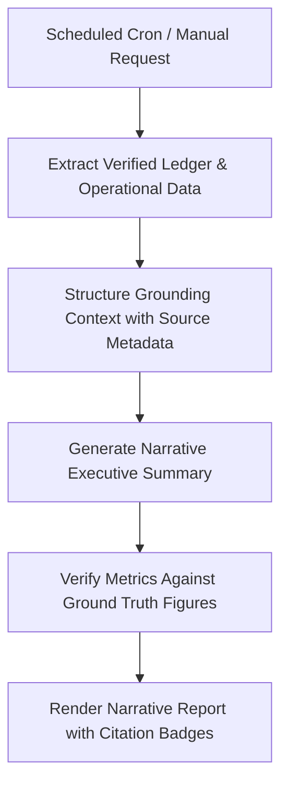

# AI-GENERATED REPORTS & AUTOMATED INSIGHTS SPECIFICATION

## 1. Automated Executive Reporting Framework
The AI Reporting Engine compiles verified tabular accounting reports into readable, narrative executive summaries in clear Bengali and English:

## 2. Mandatory Distinction Standards
Every AI report layout visually separates:
- **📊 প্রমাণিত ঐতিহাসিক ডাটা (Verified Ground Truth)**: Exact figures, account numbers, and transaction IDs.
- **💡 এআই বিশ্লেষণ ও প্রবণতা (AI Trends & Synthesis)**: Percentage shifts, pattern explanations, and potential bottlenecks.
- **🎯 নির্বাহী সুপারিশ (Strategic Recommendations)**: Advisory action points requiring human decision and approval.

Under no circumstances can the AI generate estimates and present them as historical fact.
