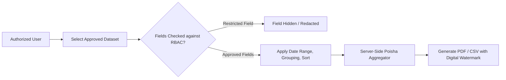

# CUSTOM REPORT BUILDER & SECURE EXPORT SPECIFICATION

## 1. Architectural Model
The Custom Report Builder allows authorized accountants and administrators to assemble flexible tabular and visual reports from pre-approved, tenant-isolated data collections.

## 2. Approved Report Datasets
1. **Member Ledger Dataset**: Member details, total savings balance, total outstanding loans, KYC status.
2. **Loan Installment Aging Dataset**: Loan ID, borrower name, disbursed principal, overdue days, penalty fee.
3. **Double-Entry Journal Dataset**: Voucher ID, posting date, debit/credit accounts, narration, maker ID.
4. **Gateway Settlement Dataset**: Provider, gross amount, MDR fee, net settled, bank deposit ref.

## 3. Data Leakage & Bulk Export Protections
- **Role Field Redaction**: Salary and personal phone numbers are excluded from exports requested by non-admin roles.
- **Audit Logging**: Every report generation and export creates an immutable log in `/somitis/{somitiId}/audit_logs` capturing user ID, IP address, timestamp, and row count.
