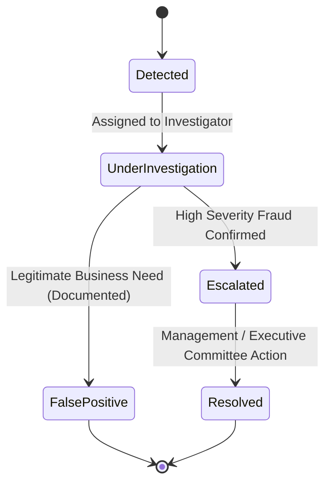

# FRAUD & ANOMALY DETECTION ENGINE SPECIFICATION

## 1. Objectives & Anomaly Detection Scope
The Anomaly Detection Engine monitors real-time operational and financial events to flag irregularities before they compound into financial loss.

## 2. Detection Rules & Risk Severity
| Rule ID | Anomaly Category | Severity | Detection Trigger Logic |
| :--- | :--- | :--- | :--- |
| `ANOM_DUP_PAY` | Duplicate Payment Attempt | **HIGH** | Same amount, member, and purpose within 120 seconds |
| `ANOM_UNUSUAL_EXP` | High Expense Outlier | **MEDIUM** | Single operational expense exceeding $3\sigma$ of 30-day average |
| `ANOM_STOCK_LEAK` | Stock Movement Discrepancy | **HIGH** | Inventory decrease with no linked sales or expense record |
| `ANOM_AUTH_FAIL` | Repeated Authorization Fail | **CRITICAL** | $\ge 5$ consecutive invalid password/OTP attempts from single IP |
| `ANOM_OFF_HOURS` | Off-Hours Cash Disbursement | **MEDIUM** | Financial journal posted between 10:00 PM and 6:00 AM |

## 3. Risk Alert Lifecycle & Investigation Workflow

AI-generated alerts are stored at `/somitis/{somitiId}/risk_alerts/{alertId}`. System accounts or member funds are **never** automatically frozen without authorized human confirmation.
