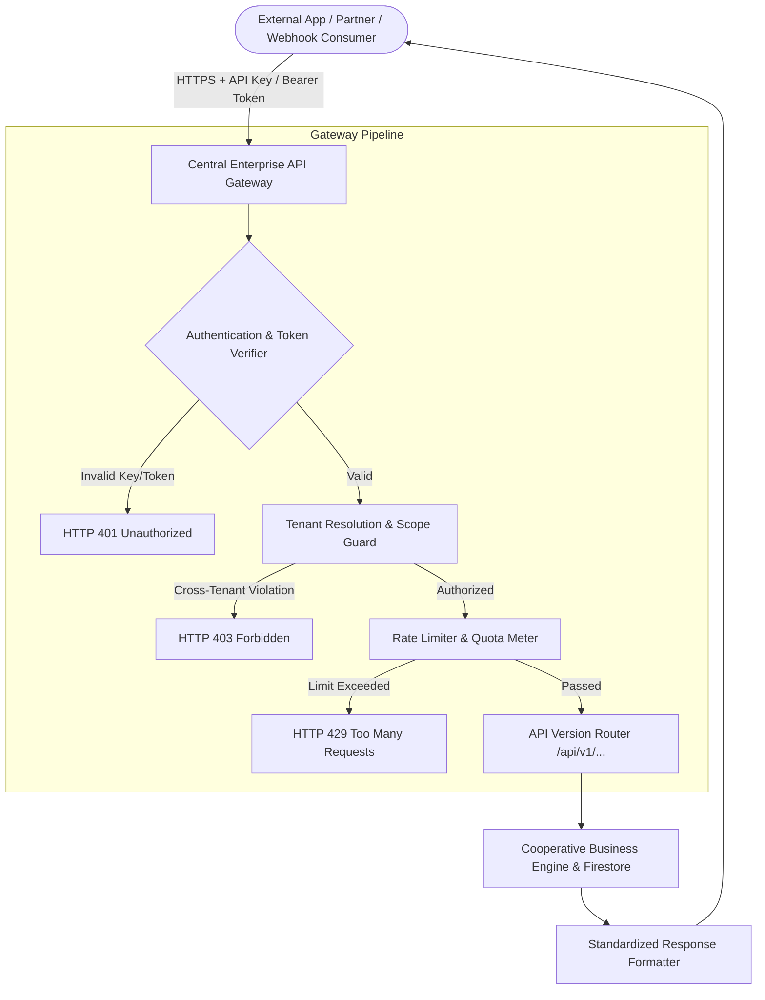

# PHASE 15 — ENTERPRISE API GATEWAY & DEVELOPER ECOSYSTEM ARCHITECTURE

## ১. ভূমিকা ও লক্ষ্য (Introduction & Objective)

"স্বপ্ন ছোঁয়া ঐক্য সমিতি" মাল্টি-টেন্যান্ট কো-অপারেটিভ ম্যানেজমেন্ট SaaS প্ল্যাটফর্মের ফেজ ১৫-এর লক্ষ্য হলো একটি নিরাপদ, স্কেলেবল, টেন্যান্ট-অ্যাওয়ার এন্টারপ্রাইজ এপিআই গেটওয়ে, ডেভেলপার পোর্টাল এবং থার্ড-পার্টি ইন্টিগ্রেশন হাব গড়ে তোলা। এর মাধ্যমে অনুমোদিত ব্যাংকিং পার্টনার, মোবাইল ফাইন্যান্সিয়াল সার্ভিস (MFS), বহিরাগত হিসাবরক্ষণ সফটওয়্যার (ERP), ফিনটেক ও অনুমোদিত ডেভেলপাররা নিরাপদ প্রোটোকলে প্ল্যাটফর্মের সাথে সংযুক্ত হতে পারবেন।

---

## ২. এপিআই গেটওয়ে আর্কিটেকচার (API Gateway Architecture)

### প্রধান ফিচার ও নীতিমালা:
1. **টেন্যান্ট আইসোলেশন (Tenant Isolation Invariant):**
   - প্রতিটি এপিআই কী বা ওঅথ ক্লায়েন্ট নির্দিষ্ট `societyId` (বা প্ল্যাটফর্ম সুপার এডমিন স্কোপ)-এর সাথে যুক্ত।
   - ক্রস-সমিতি ডাটা কুয়েরি গেটওয়ে স্তরেই সম্পূর্ণ রিজেক্ট হবে (BOLA/IDOR প্রতিরোধ)।
2. **রেট লিমিটিং ও থ্রটলিং (Rate Limiting):**
   - টোকেন বাকেট / স্লাইডিং উইন্ডো অ্যালগরিদম।
   - ফ্রি টিয়ার: ৬০ রিকোয়েস্ট/মিনিট, স্ট্যান্ডার্ড টিয়ার: ৩০০ রিকোয়েস্ট/মিনিট, এন্টারপ্রাইজ টিয়ার: ১,২০০ রিকোয়েস্ট/মিনিট।
3. **প্রমিত রেসপন্স ও এরর ফরম্যাট (Standard Response):**
   - সকল রেসপন্সে `success`, `data`, `meta` (pagination, version, timestamp) এবং এররের ক্ষেত্রে `error` কোড ও বিস্তারিত বার্তা থাকবে।
4. **ভার্সনিং প্রোটোকল (Versioning):**
   - `/api/v1/...` (বর্তমান স্থিতিশীল সংস্করণ), `/api/v2/...` (উন্নত সংস্করণ প্রিভিউ)। কোনো ব্রেকিং পরিবর্তন পূর্বঘোষণা ছাড়া প্রকাশ করা নিষিদ্ধ।

---

## ৩. কোর এপিআই এন্ডপয়েন্ট ক্যাটালগ (Core REST API Endpoints)

| মেথড | এন্ডপয়েন্ট | বিবরণ | আবশ্যক স্কোপ |
| :---: | :--- | :--- | :---: |
| **POST** | `/api/v1/auth/token` | ওঅথ ২.০ টোকেন জেনারেট (Client Credentials) | `auth:token` |
| **GET** | `/api/v1/society/profile` | সমিতির প্রোফাইল ও বিবরণ দেখা | `society:read` |
| **GET** | `/api/v1/members` | ফিল্টার সহ সদস্য তালিকা অনুসন্ধান | `members:read` |
| **POST** | `/api/v1/members` | নতুন সদস্য নিবন্ধন | `members:create` |
| **GET** | `/api/v1/savings/accounts` | সদস্যের সঞ্চয় হিসাব ও ব্যালেন্স | `savings:read` |
| **POST** | `/api/v1/savings/deposits` | কিস্তি জমা গ্রহণ ও ডিজিটাল ভাউচার জেনারেট | `savings:deposit` |
| **GET** | `/api/v1/loans` | ঋণ তালিকা ও কিস্তি পরিশোধের সময়সূচি | `loans:read` |
| **POST** | `/api/v1/loans/apply` | নতুন ঋণের আবেদন দাখিল | `loans:apply` |
| **POST** | `/api/v1/loans/repay` | ঋণের কিস্তি পরিশোধ গ্রহণ | `loans:repay` |
| **GET** | `/api/v1/accounting/trial-balance` | ডাবল-এন্ট্রি খতিয়ান ট্রায়াল ব্যালেন্স | `accounting:read` |
| **POST** | `/api/v1/payments/initiate` | বিকাশ/নগদ পেমেন্ট গেটওয়ে ইনিশিয়েট | `payments:initiate` |
| **POST** | `/api/v1/payments/verify` | পেমেন্ট স্ট্যাটাস ও ট্রানজেকশন যাচাই | `payments:verify` |
| **GET** | `/api/v1/webhooks` | সাবস্ক্রাইবকৃত ওয়েবহুক তালিকা | `webhooks:manage` |
| **POST** | `/api/v1/webhooks` | নতুন ওয়েবহুক এন্ডপয়েন্ট নিবন্ধন | `webhooks:manage` |
