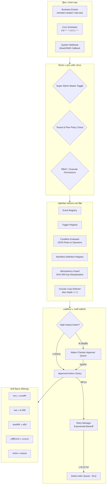

# ফেজ ২০: এন্টারপ্রাইজ অটোমেশন ও অটোনোমাস অপারেশনস ইঞ্জিন আর্কিটেকচার
(Phase 20: Enterprise Automation & Autonomous Operations Engine Architecture)

## ১. ভূমিকা ও লক্ষ্য (Introduction & Vision)
স্বপ্ন ছোঁয়া ঐক্য সমিতি প্ল্যাটফর্মের ফেজ ২০ এন্টারপ্রাইজ অটোমেশন ও অটোনোমাস অপারেশনস ইঞ্জিন হলো একটি কেন্দ্রীভূত, ইভেন্ট-চালিত (event-driven) এবং কনফিগারযোগ্য ব্যবসায়িক প্রসেস অটোমেশন ফ্রেমওয়ার্ক। এর উদ্দেশ্য হলো বহুমুখী পুনরাবৃত্তিমূলক অপারেশনাল কাজসমূহ (যেমন: কিস্তি বকেয়া সতর্কতা, সঞ্চয় মেচিউরিটি রিমাইন্ডার, বার্ষিক কমপ্লায়েন্স অ্যালার্ট, মেম্বার অনবোর্ডিং চেকলিস্ট, সিস্টেম অডিট ট্র্যাকিং) স্বয়ংক্রিয়ভাবে সম্পাদন করা, যার ফলে প্রশাসনিক কাজের গতি বহুগুণ বৃদ্ধি পায় এবং মানবীয় ভুলভ্রান্তি শূন্যের কোটায় নেমে আসে।

> [!IMPORTANT]
> **আর্থিক ও নিরাপত্তা অপরিবর্তনীয় নীতিমালা (Inviolable Financial & Security Invariants):**
> অটোমেশন ইঞ্জিন কখনই স্বত্বাধিকারী/মানবীয় অনুমোদন ব্যতিরেকে কোনো উচ্চঝুঁকিপূর্ণ আর্থিক লেনদেন (যেমন: সরাসরি লোন অর্থ বিতরণ বা ঋণ মওকুফ, সঞ্চয় তহবিল স্থানান্তর বা হিসাব বাতিলকরণ) নিজে নিজে চূড়ান্ত পোস্ট করবে না। অটোমেশন কেবল হিসাব প্রস্তুত, পূর্বশর্ত যাচাই এবং **মেকার-চেকার (Maker-Checker)** অনুমোদন কিউতে প্রস্তাব পাঠাতে পারবে।

---

## ২. কোর ইঞ্জিন উপাদানসমূহ (Core Architecture Components)



### প্রধান উপাদানসমূহ:
1. **Event Registry**: প্ল্যাটফর্মের অনুমোদিত বিজনেস ইভেন্ট তালিকা (`member.created`, `savings.deposit.completed`, `loan.installment.due`, `subscription.expired`, `compliance.deadline.approaching`) নিবন্ধন ও ভ্যালিডেশন করে।
2. **Trigger Registry**: তিন ধরনের ট্রিগার সাপোর্ট করে:
   - *ইভেন্ট-চালিত (Event-Driven)*: ডাটাবেজ চেঞ্জ বা সিস্টেমে কোনো অ্যাকশন সম্পন্ন হলে ট্রিগার হয়।
   - *শিডিউলড ক্রোন (Scheduled Cron)*: নির্দিষ্ট সময়সূচি (যেমন: প্রতিদিন সকাল ৮টায় বা প্রতি মাসের ১ তারিখ) অনুযায়ী রান করে।
   - *থ্রেশহোল্ড/মেট্রিক ড্রাইভেন (Metric-Driven)*: ঝুঁকি বা ব্যালেন্স থ্রেশহোল্ড অতিক্রম করলে সক্রিয় হয়।
3. **Condition Evaluator**: জটিল লজিক্যাল রুলস (`AND`, `OR`, `EQUALS`, `GREATER_THAN`, `IN`, `CONTAINS`) মূল্যায়ন করে।
4. **Idempotency Guard**: একই ইভেন্ট যাতে একাধিকবার প্রসেস না হয় সেজন্য প্রতিটি ইভেন্টের জন্য সুনির্দিষ্ট SHA-256 আইডেমপোটেন্সি কি (`tenantId:eventType:entityId:windowKey`) তৈরি ও ট্র্যাক করে।
5. **Recursion Loop Detector**: অটোমেশন অ্যাকশন পুনরায় নতুন ইভেন্ট ট্রিগার করে অসীম লুপ তৈরি না করে তা নিশ্চিত করতে ম্যাক্সিমাম এক্সেকিউশন ডেপথ ৩ নির্ধারণ করা হয়েছে।
6. **Action Registry**: পূর্ব-অনুমোদিত এবং স্যান্ডবক্সড অ্যাকশনসমূহ (বিজ্ঞপ্তি পাঠানো, ড্রাফট তৈরি, টাস্ক বরাদ্দ, স্টেটাস আপডেট) এক্সিকিউট করে।
7. **Maker-Checker Approval Queue**: ঋণ অনুমোদন বা ফান্ড উইথড্রয়ালের মতো ঝুঁকিপূর্ণ অ্যাকশনকে সরাসরি ব্লক করে মানবীয় অনুমোদনের জন্য অপেক্ষারত রাখে।
8. **Retry Manager & Dead-Letter Queue (DLQ)**: ব্যর্থ এক্সিকিউশনগুলোকে এক্সপোনেনশিয়াল ব্যাকঅফ (`2^n * 30s`) সহ ৩ বার পুনরায় চেষ্টা করে এবং ব্যর্থ হলে DLQ-তে সংরক্ষণ করে এডমিনকে নোটিফাই করে।

---

## ৩. স্ট্যান্ডার্ড অটোমেশন লাইফসাইকেল (Automation Lifecycle State Machine)

```
[DRAFT] --> [PENDING_APPROVAL] --> [ACTIVE] <--> [PAUSED]
                                      |
                     [TRIGGER DETECTED]
                                      v
                             [EVALUATING RULES]
                                      v
                            [IDEMPOTENCY CHECK]
                                  /         \
                            [DUPLICATE]    [VALID]
                                 |            v
                              [SKIP]     [HIGH-IMPACT?]
                                         /            \
                                    [YES]              [NO]
                                      v                  v
                               [QUEUE APPROVAL]     [EXECUTE NOW]
                                      |                  |
                                [HUMAN DECIDES]       [SUCCESS]
                                 /          \            |
                            [APPROVED]  [REJECTED]  [AUDIT LOG]
                                 |           |
                           [EXECUTE NOW]  [CANCELLED]
```

---

## ৪. সুপার এডমিন ৮-স্তরের নিয়ন্ত্রণ ও ইনভেরিয়েন্ট নীতি (8-Tier Controls)
1. **প্ল্যাটফর্ম গ্লোবাল লেভেল (Global Platform Level)**: সুপার এডমিন এক ক্লিকে সম্পূর্ণ প্ল্যাটফর্মের জন্য সমস্ত স্বয়ংক্রিয় প্রসেস বন্ধ করতে পারেন।
2. **সমিতি লেভেল (Society Level)**: নির্দিষ্ট সমিতির অটোমেশন ইঞ্জিন চালু বা সাময়িক নিষ্ক্রিয় করা।
3. **সাবস্ক্রিপশন প্ল্যান লেভেল (Subscription-Plan Level)**: বেসিক প্ল্যানে সীমিত শিডিউলড জব এবং এন্টারপ্রাইজ প্ল্যানে আনলিমিটেড রিয়েল-টাইম ওয়ার্কফ্লো বরাদ্দ।
4. **মডিউল লেভেল (Module Level)**: কেবল ঋণ বা সঞ্চয় মডিউলের অটোমেশন নিয়ন্ত্রণ।
5. **ফিচার লেভেল (Feature Level)**: এসএমএস নোটিফিকেশন বা অডিট রিকনসিলিয়েশন ইন্ডিভিজুয়াল টগল।
6. **ওয়ার্কফ্লো লেভেল (Workflow Level)**: একক ওয়ার্কফ্লো অন/অফ করা।
7. **ট্রিগার লেভেল (Trigger Level)**: নির্দিষ্ট কোনো ক্রোন বা ইভেন্ট লিসেনার মিউট করা।
8. **অ্যাকশন লেভেল (Action Level)**: নির্দিষ্ট বাহ্যিক ওয়েবহুক কল বা এসএমএস ড্রেনিং রোধ করা।

> [!NOTE]
> কোনো টগলই সিস্টেমে সংরক্ষিত আগের এক্সিকিউশন লগ, অডিট ট্রেইল বা ডেড-লেটার রেকর্ড মুছে ফেলতে পারবে না।
