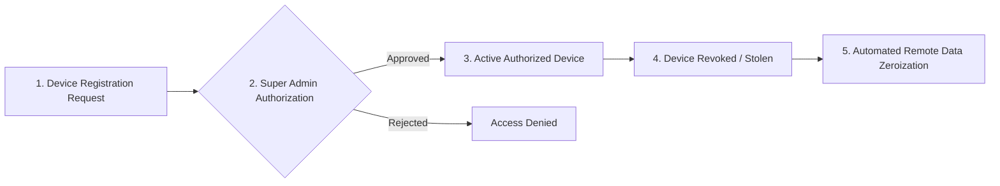

# DEVICE REGISTRATION & HARDWARE FLEET MANAGEMENT

## 1. Device Fleet Lifecycle
To prevent unauthorized devices from connecting to sensitive cooperative financial databases, all field devices (smartphones, tablets, portable Bluetooth receipt printers) must be registered:

## 2. Device Metadata Schema
- `deviceId`: Unique hardware fingerprint (UUIDv5 derived from Android ID / iOS IDFV).
- `deviceName`: Model (e.g., `Samsung Galaxy Tab A9+`, `Xiaomi Redmi Note 13`).
- `assignedOfficer`: Officer name & ID.
- `status`: `PENDING_APPROVAL`, `ACTIVE`, `SUSPENDED`, `REVOKED`.
- `lastSyncAt`: Timestamp of last successful synchronization.
- `appVersion`: Installed application build number.
