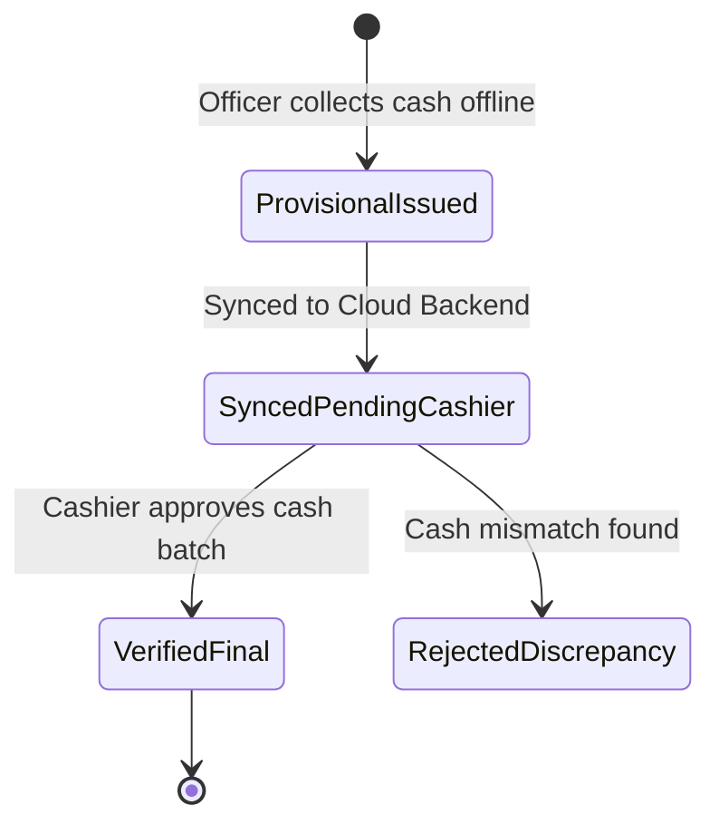

# OFFLINE COLLECTIONS & PROVISIONAL RECEIPT SPECIFICATION

## 1. Collection Workflow & Data Invariants
1. **Integer Arithmetic**: All collections must be entered in integer Poisha to prevent precision drift.
2. **Mandatory Category Classification**:
   - `memberSavingsDeposit`: Liability to member (Account 2110).
   - `loanInstallmentRepayment`: Asset reduction (Account 1141 Principal + Account 4110 Interest).
   - `membershipFee`: General Revenue (Account 4210).
3. **Provisional Receipt Elements**:
   - Organization Name: `স্বপ্ন ছোঁয়া ঐক্য সমিতি`
   - Header Notice: `*** সাময়িক রসিদ (অনলাইন সার্ভার যাচাই অপেক্ষমান) ***`
   - Unique Provisional Number: `PROV-REC-${timestamp}-${random}`
   - Member Name & Assigned ID
   - Collection Purpose & Amount (BDT `৳`)
   - Collecting Field Officer Name & ID
   - Timestamp and GPS coordinate stamp

## 2. Receipt Status Transitions

Provisional receipts clearly warn the member that final accounting credit occurs once verified by the cooperative branch cashier.
