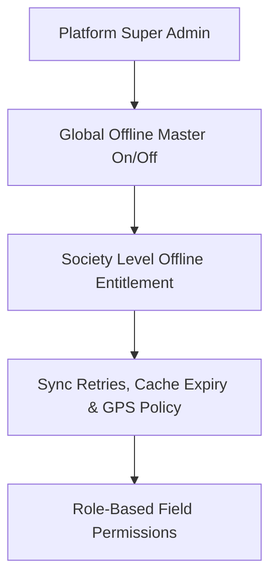

# SUPER ADMIN OFFLINE, FIELD & SYNC CONTROL CENTER

## 1. Governance Architecture
Super Admin maintains centralized, immutable control over every offline capability, sync trigger, device authorization, and location policy across all societies:

## 2. Granular Controls Available to Super Admin
1. **Master Offline Switch**: Disable offline operation globally across all societies during emergency audit windows.
2. **Society Offline Cache Duration**: Set max offline window ($12\text{h}$, $24\text{h}$, or $48\text{h}$).
3. **Location Requirement Switch**: Toggle whether GPS coordinates must be attached to field collection receipts.
4. **Device Authorization Approval**: Review, authorize, or revoke field tablet devices.
5. **Conflict Resolution Intervention**: Review escalated financial conflicts between field officers and branch cashiers.
