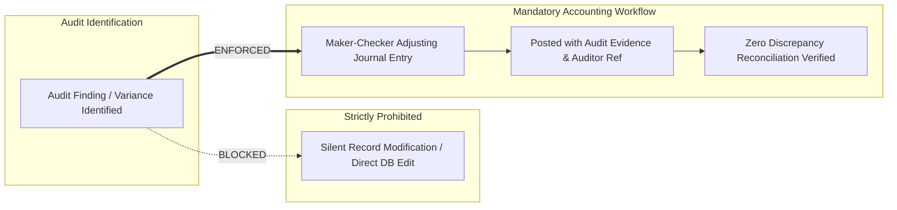

# Internal Audit Methodology, Risk Classification & Financial Reconciliation

## 1. Internal Audit Objective

The **Internal Audit Management System** enables the society's internal Audit Committee (নিরীক্ষা কমিটি) and appointed compliance officers to conduct systematic, independent appraisals of financial records, internal controls, operational processes, and governance integrity.

---

## 2. Risk Classification Framework

| Risk Rating | Definition | Resolution SLA | Escalation Protocol |
| :--- | :--- | :--- | :--- |
| **Critical / High (উচ্চ ঝুঁকি)** | Material cash variance, unposted transactions, default in statutory reserve allocation, fraud risk, unauthorized loans. | 7 Days | Immediate alert to Board of Directors & Super Admin |
| **Medium (মাঝারি ঝুঁকি)** | Missing voucher attachments, delay in bank reconciliation, overdue loan documentation, incomplete KYC. | 30 Days | Reported in monthly Board Meeting |
| **Low (নিম্ন ঝুঁকি)** | Minor typographical errors, delayed receipt generation, minor record archiving delays. | 60 Days | Assigned to branch manager for periodic review |

---

## 3. Financial Audit & Reconciliation Invariant

### Immutable Principle: Non-Destructive Accounting
- An auditor **cannot** edit or delete an existing posted transaction in `deposits`, `expenses`, or `journal_entries`.
- All reconciliations must produce formal **Reversal Journals** or **Adjustment Journals** (`AccountingAdjustmentModel`) referencing the original audit finding ID (`auditFindingId`), signed by both the Auditor and the Managing Committee Secretary.

---

## 4. Standard Audit Checklists & Verification Scope

1. **Cashbook & Vault Audit**:
   - Physical cash count vs. `GL[1001]` Cash-in-Hand balance.
   - Dual-custody vault key verification.
2. **Bank Reconciliation Audit**:
   - Bank statement balance vs. `GL[1003]` ledger balance.
   - Uncredited cheques and outstanding deposit verification.
3. **Savings & Member Deposit Audit**:
   - Total member passbook balances vs. `GL[2001]` Savings Liability.
   - Verification of withdrawal request maker-checker approvals.
4. **Loan Portfolio Audit**:
   - Active loan agreements, guarantor forms, and NID copies.
   - Portfolio-at-Risk (PAR 30/60/90) classification and reserve sufficiency.
5. **Statutory Reserve Fund Audit**:
   - Verification of 15% statutory profit allocation per Co-operative Societies Act 2001, Section 34.
