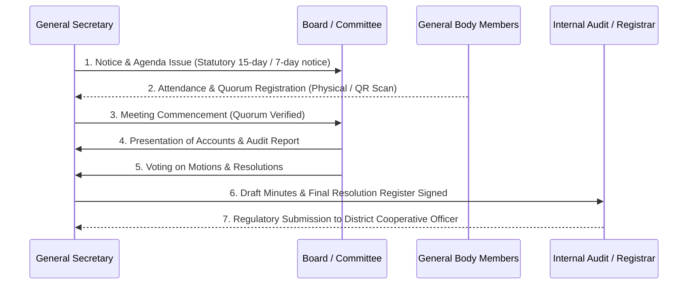

# Phase 19: Enterprise Cooperative Governance, Audit & Regulatory Compliance System Architecture

## 1. Executive Summary

The **Enterprise Cooperative Governance, Audit & Regulatory Compliance System** provides a digital governance backbone for cooperative societies operating under the SaaS platform ("স্বপ্ন ছোঁয়া ঐক্য সমিতি" / `cloud_sync_drive`). It supports the full administrative lifecycle of cooperative societies: Managing Committee / Board administration, sub-committee appointments, General Body / AGM management, structured resolution registers, election administration, internal audit oversight, and statutory regulatory compliance management.

```mermaid
flowchart TD
    subgraph GovernanceCore["Cooperative Governance Engine (Phase 19)"]
        MC[Managing Committee / Board of Directors]
        AC[Audit Committee]
        EC[Election Committee]
        GB[General Body / AGM]
    end

    subgraph AdministrationWorkflows["Operational Workflows"]
        Meet[Board & AGM Meeting Management]
        Res[Resolution & Decision Register]
        Elec[Election & Voter Roll Administration]
        Audit[Internal Audit & Risk Findings]
        Comp[Statutory Compliance Registry]
    end

    subgraph CorePlatform["Integrated SaaS Foundations (Reused)"]
        GL[Double-Entry General Ledger (Phase 2)]
        WF[Maker-Checker Workflow (Phase 3)]
        SEC[Security & Compliance RBAC (Phase 4)]
        EDW[Enterprise Data Warehouse (Phase 17)]
        MEM[Member Super App (Phase 18)]
    end

    GovernanceCore --> AdministrationWorkflows
    AdministrationWorkflows --> GL
    AdministrationWorkflows --> WF
    AdministrationWorkflows --> SEC
    AdministrationWorkflows --> EDW
    AdministrationWorkflows --> MEM
```

---

## 2. Governance Hierarchy & Roles

In accordance with democratic cooperative principles and society bylaws, each society can configure:
1. **General Body (সাধারণ সভা)**: Supreme authority comprising all active registered members (`dim_members`).
2. **Managing Committee / Board of Directors (ব্যবস্থাপনা কমিটি / পরিচালনা পর্ষদ)**: Elected executive committee responsible for operational governance.
   - **Chairman / President (সভাপতি)**: Presides over board meetings and AGMs.
   - **Vice Chairman (সহ-সভাপতি)**: Deputizes for the Chairman.
   - **General Secretary (সাধারণ সম্পাদক)**: Chief executive and records custodian.
   - **Treasurer / Cashier (কোষাধ্যক্ষ)**: Custodian of financial registers and cash management.
   - **Executive Members (নির্বাহী সদস্য)**: Voting board members.
3. **Audit Committee (নিরীক্ষা কমিটি)**: Independent internal oversight body reporting directly to the General Body.
4. **Election Committee (নির্বাচন কমিশন)**: Neutral ad-hoc body appointed to conduct committee elections.

---

## 3. Meeting & AGM Lifecycle Management



---

## 4. Super Admin Universal ON/OFF Control Matrix

Every governance and audit capability is subject to centralized Super Admin policy toggles:
- **Global Platform Level**: Master switch for the governance module (`cooperative_governance`).
- **Society Level**: Enable/disable electronic AGM notices or election registers per society.
- **Role & Action Level**: Strict separation of duties between General Secretary, Chairman, and Audit Committee.

> [!IMPORTANT]
> **Immutable Invariants**:
> 1. Approved board resolutions cannot be deleted or overwritten silently; revisions require formal amending resolutions.
> 2. Financial records cannot be altered during internal audit; adjustments require authorized ledger reversal vouchers.
> 3. Tenant isolation prevents cross-society access to confidential board minutes or election ballots.
