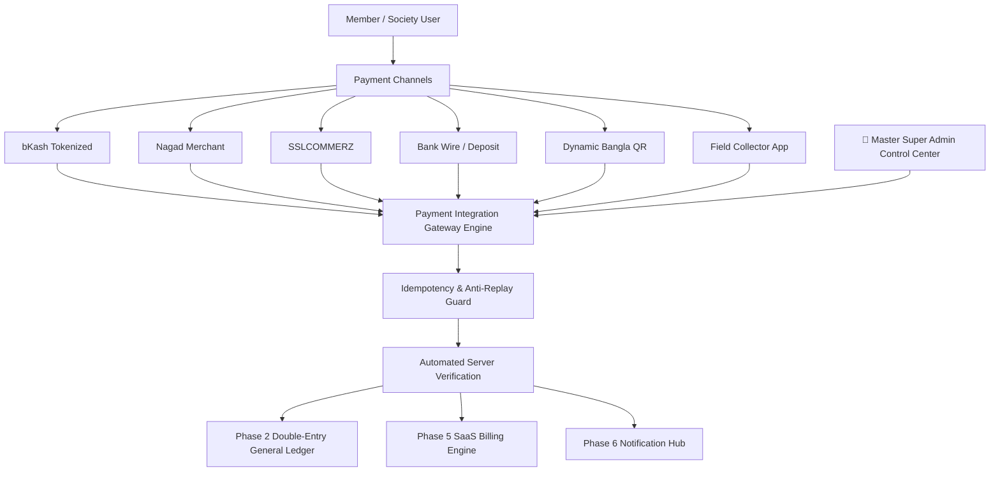

# PHASE_7_ARCHITECTURE.md — Enterprise Payment, Banking & Financial Integration Ecosystem

## 1. Executive Summary
Phase 7 introduces a provider-agnostic, bank-grade payment and banking integration architecture. It interfaces with Bangladesh's premier payment rails:
- **MFS (Mobile Financial Services)**: bKash Tokenized Merchant API, Nagad Direct Merchant PGW.
- **Card & Internet Banking**: SSLCOMMERZ Hosted Gateway (Visa, Mastercard, Amex, UnionPay, Internet Banking).
- **Commercial Banking**: Bank transfer verification, automated statement import (CSV/Excel), and 3-way reconciliation.
- **QR Payment Infrastructure**: Dynamic member-specific and installment-specific QR codes with replay protection.
- **Offline/Mobile Field Collections**: Tamper-proof field collection registers with two-step maker-checker verification.

## 2. Fundamental Architectural Invariants
1. **Never Trust Client Status**: No client app can mark an online payment, deposit, or loan repayment as "PAID" or "SUCCESS".
2. **Integer Poisha Precision**: All money math uses integer Poisha ($1\text{ BDT} = 100\text{ Poisha}$).
3. **Idempotency Keys**: Deterministic UUID/HMAC prevents duplicate debit/credit or double-charging.
4. **Tenant & Fund Segregation**: Platform SaaS fees and society microfinance funds remain strictly isolated in segregated charts of accounts.
