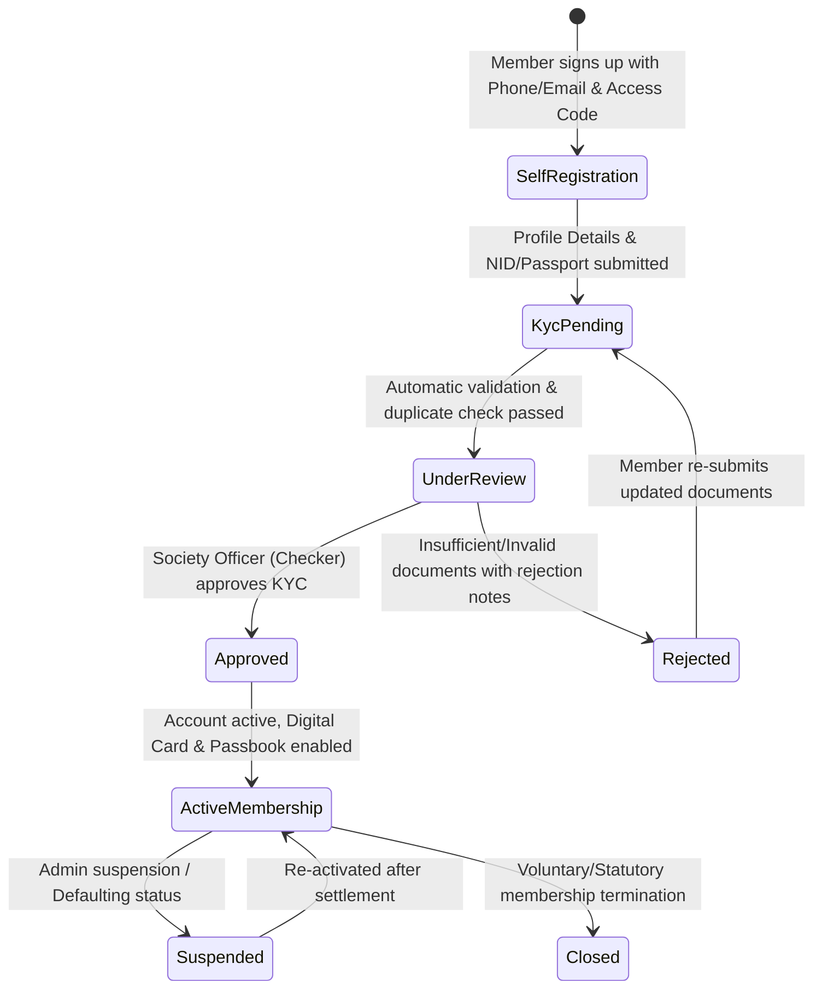

# Member Onboarding, KYC & Approval Workflow Architecture

## 1. Member Onboarding Lifecycle

---

## 2. Mandatory Verification & Anti-Duplicate Controls

1. **National ID (NID) & Phone Uniqueness**:
   - Each cooperative society member within a tenant must have a strictly unique combination of NID number and verified mobile phone number.
   - Cross-society matching detects duplicate registrations across cooperatives to protect credit integrity while maintaining strict privacy boundaries.
2. **Access Code Verification**:
   - Onboarding requires an authorized Society Invitation Token or pre-registered Member Registration Code issued by the Managing Committee.
3. **No Member Self-Approval Invariant**:
   - Members are restricted from updating their membership tier, credit limit, or KYC status directly.
   - All KYC submissions are routed to the **Phase 3 Maker-Checker Approval Center** (`/somitis/{somitiId}/workflows/`).
   - Society General Secretary or designated Branch Officer must inspect document image hashes before changing status to `verified`.

---

## 3. KYC Document Classification & Handling

| Document Type | Verification Rules | Retention Period | Storage Privacy |
| :--- | :--- | :--- | :--- |
| **NID (Smart Card / 10-17 Digit)** | Format validation, duplicate check | 10 Years (Co-op Act 2001) | Private Firebase Bucket, Encrypted |
| **Member Photograph** | Max 2MB, JPEG/PNG, face detected | Lifelong membership | CDN Cached with Signed URL |
| **Nominee Identity & Photo** | Nominee NID & relation verification | Lifelong membership | Encrypted Storage |
| **Signature Specimen** | Digital signature or scanned paper | Lifelong membership | Strictly Protected Access |

---

## 4. Audit Trail & Change Logging

Every step in the onboarding and KYC pipeline records:
- `actorUid`: The user performing the action (Member or Approving Officer).
- `previousStatus` & `newStatus`.
- `reasonBn`: Rejection explanation in Bengali where applicable.
- `timestamp`: UTC ISO-8601 server timestamp.
- Cryptographic hash chaining in compliance with the **Phase 4 Security & Compliance Engine**.
