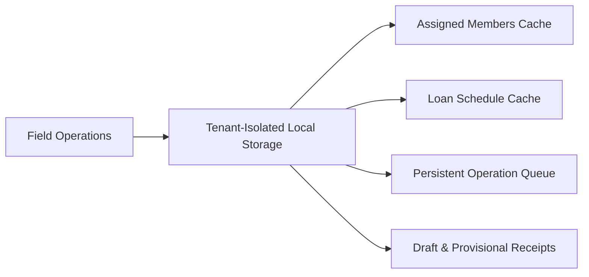

# OFFLINE-FIRST STRATEGY & CACHING ARCHITECTURE

## 1. Local Persistence Architecture
The offline layer is designed for extreme resilience across mobile (Android/iOS) and Web environments:

## 2. Cached Datasets & Freshness Window
Field officers cache only the records required for their daily route:
1. **Assigned Members**: Member ID, name, photo, father/husband name, phone, savings balance summary, active loan installment due.
2. **Loan Installment Schedules**: Loan account number, installment number, due date, principal poisha, interest poisha, penalty poisha.
3. **Daily Collection Route**: Geolocation targets, visit order, priority tags.

### Data Freshness Policies:
- Maximum offline cache duration: **48 hours** (enforced by Super Admin policy).
- If a device remains offline past 48 hours without syncing, financial operations lock automatically until online re-authentication occurs.

## 3. Storage Optimization & Multi-Tenant Separation
- Cache keys follow the strict pattern: `${societyId}:${officerId}:${recordType}:${recordId}`.
- Switching user or society flushes unassociated cached datasets to prevent data leakage on shared cooperative field tablets.
