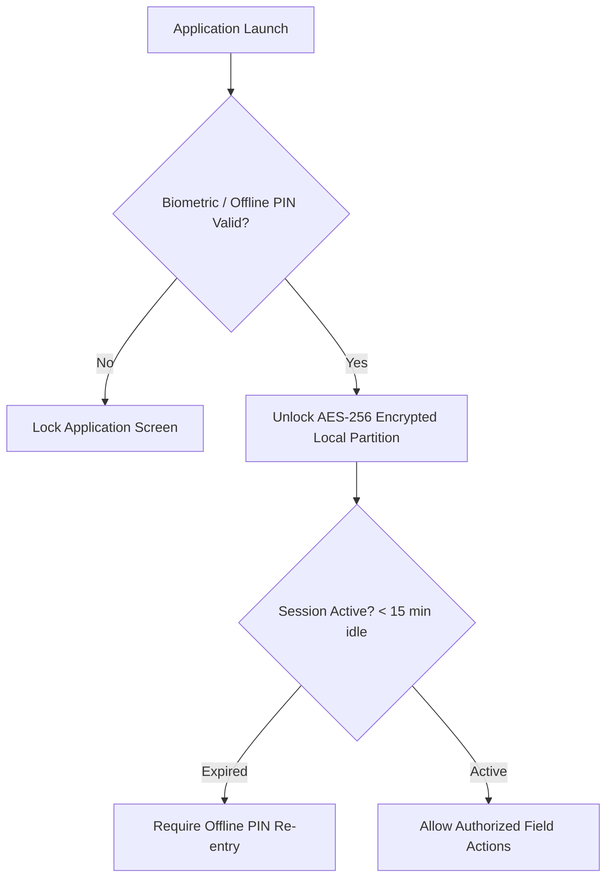

# OFFLINE SECURITY, ENCRYPTION & DATA MINIMIZATION

## 1. Threat Model for Offline Field Devices
Mobile tablets and smartphones deployed in rural areas face physical theft, unauthorized sharing, and tampering. Phase 9 implements defense-in-depth protections:

## 2. Core Security Invariants
1. **At-Rest Encryption**:
   - The local database and cached photos are encrypted using AES-GCM 256-bit encryption. The decryption key is derived using PBKDF2 with HMAC-SHA256 from the officer's offline PIN and device hardware Keystore.
2. **Data Minimization**:
   - Field officers only download records for members assigned to their specific collection cluster/route. Full society databases are never cached.
3. **Remote Wipe on Device Revocation**:
   - When a device is revoked by the Super Admin, the next background ping triggers an immediate zeroization of all local SQLite databases and cached media.
