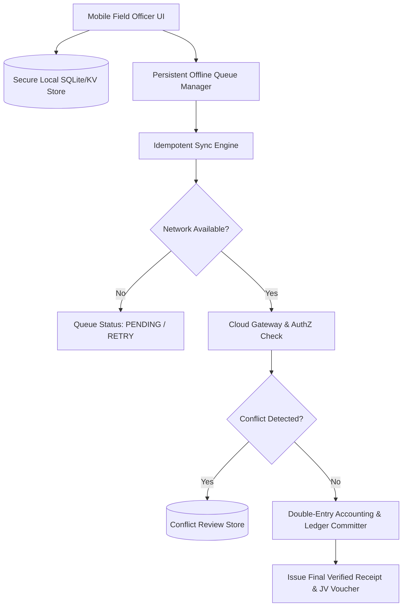

# PHASE 9 — ENTERPRISE OFFLINE-FIRST ARCHITECTURE & FIELD OPERATIONS

## 1. Executive Summary & Architectural Overview
Phase 9 equips the **Multi-Society Cooperative SaaS Platform ("স্বপ্ন ছোঁয়া ঐক্য সমিতি")** with an enterprise-grade, offline-first operating engine. Designed specifically for rural microfinance field officers, door-to-door deposit collectors, and remote credit inspectors who operate in areas with intermittent 2G/3G connectivity or complete network blackouts.

## 2. Core Architectural Principles
1. **Never Assume Network Connectivity**:
   - Every field workflow (member lookup, passbook summary, installment collection, KYC photo capture) functions without internet access.
2. **Provisional Receipt Invariant**:
   - Any money receipt generated on a mobile device while offline is explicitly stamped:
     `"PENDING SERVER VERIFICATION — সাময়িক রসিদ (অনলাইন নিশ্চিতকরণ অপেক্ষমান)"`.
   - Provisional receipts do **never** post to the General Ledger until server-side verification commits the transaction.
3. **Deterministic Idempotency**:
   - Every offline operation is tagged with a client-generated UUID (`opId`). Repeated transmissions during network reconnects will never create duplicate financial entries or double deposits.
4. **Zero Silent Overwrites**:
   - Conflicts on financial balances are never resolved with naive "last-write-wins". They enter a `REQUIRES_REVIEW` state requiring authorized cashier or supervisor reconciliation.
5. **Separation of Duties (Maker-Checker)**:
   - A field collector submitting an offline collection cannot self-approve or reconcile their own cash bag. The branch cashier must verify the physical cash before marking the collection batch as reconciled.

## 3. Supported Connectivity States
| State | Label in UI | System Behavior |
| :--- | :--- | :--- |
| `ONLINE` | 🟢 অনলাইন (সরাসরি সংযোগ) | Real-time Firebase Firestore live sync active |
| `OFFLINE` | 🔴 অফলাইন (লোকাল মোড) | Read/write from local store; queue operations |
| `CONNECTING` | 🟡 নেটওয়ার্ক সন্ধানরত... | Handshaking and connectivity ping |
| `SYNCING` | 🔄 সিঙ্ক হচ্ছে... | Transmitting pending operations in FIFO order |
| `SYNC_PENDING` | ⏳ সিঙ্ক অপেক্ষমান | Operations queued locally waiting for trigger |
| `SYNC_FAILED` | ⚠️ সিঙ্ক ব্যর্থ | Network dropped or temporary 5xx error |
| `SYNC_CONFLICT` | ❗ সিঙ্ক কনফ্লিক্ট | Data version mismatch; human review required |
| `PARTIALLY_SYNCED` | 🟨 আংশিক সম্পন্ন | Transactions committed; heavy photos in queue |
