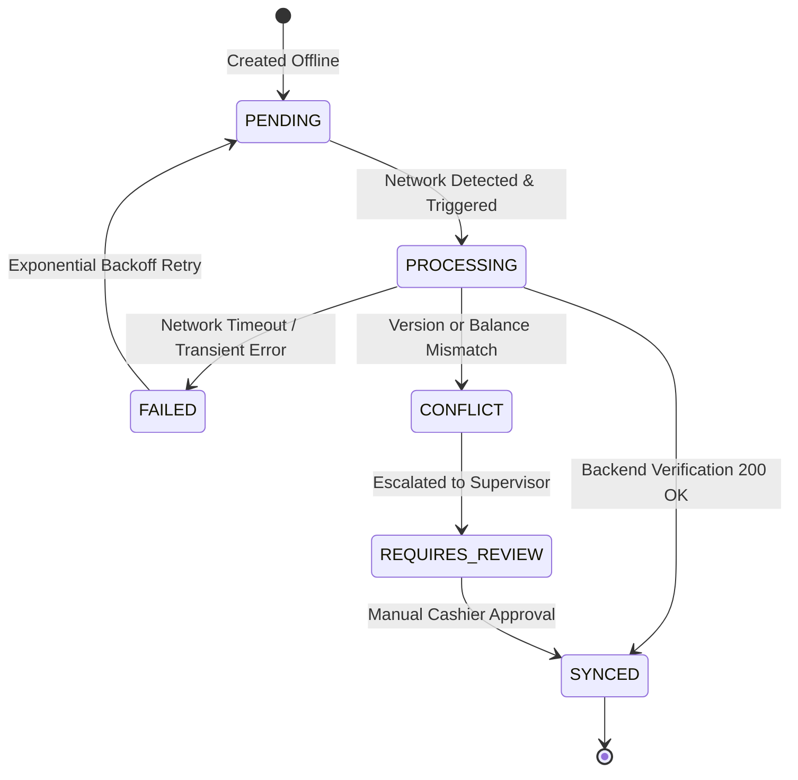

# RELIABLE SYNCHRONIZATION ENGINE & IDEMPOTENCY

## 1. Synchronization Queue Lifecycle
Every action initiated offline (savings collection, loan repayment, member profile note, KYC capture) is stored as a persistent queue item:



## 2. Queue Item Payload Structure
```json
{
  "operationId": "op_csh_20261114_8819_01",
  "societyId": "swapno_chowa_main",
  "userId": "emp_field_01",
  "deviceId": "dev_samsung_tab_09",
  "operationType": "FIELD_COLLECTION",
  "payload": {
    "memberId": "mem_001",
    "purpose": "memberSavingsDeposit",
    "amountPoisha": 150000,
    "collectedAt": "2026-11-14T09:30:00Z",
    "provisionalReceiptNumber": "PROV-REC-8819",
    "gpsLat": 23.8041,
    "gpsLng": 90.3667
  },
  "retryCount": 0,
  "status": "PENDING",
  "createdAt": "2026-11-14T09:30:01Z"
}
```

## 3. Idempotency & Replay Defense
1. The `operationId` acts as a unique idempotency key on the backend Firestore `/somitis/{somitiId}/payment_transactions`.
2. If network cuts off during response transmission and the client retries, the backend checks:
   ```firestore
   if exists(/databases/$(database)/documents/somitis/$(societyId)/payment_transactions/$(operationId))
       return existingTransaction; // Prevent double posting!
   ```
3. Exponential Backoff Policy: Base $2\text{s}$, multiplier $2.0$, maximum jittered delay $60\text{s}$, maximum retries $5$.
