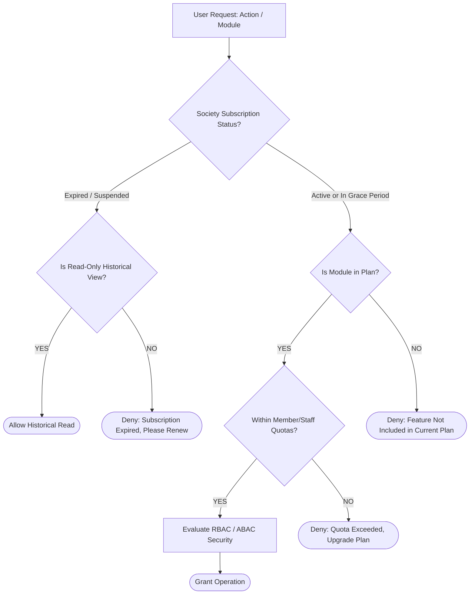

# PHASE 5: DYNAMIC PLAN ENTITLEMENT ENGINE & USAGE QUOTAS

**Project:** Multi-Society Cooperative Management SaaS Platform  
**Target:** Server-Authoritative Feature Gating & Quota Enforcement  

---

## 1. Entitlement Evaluation Precedence

When a user in a society requests an operation, the engine evaluates entitlements seamlessly:

---

## 2. Quota Protection Rules
- **Non-Destructive Over-Quota Behavior**: If a society has 450 members on Standard Plan and downgrades to Starter Plan (100 members max), existing 450 member records remain completely intact and searchable. Only new member creation is blocked until upgrade.
- **Quota Keys**: `members_count`, `staff_count`, `monthly_disbursement_volume`, `cloud_storage_mb`.
