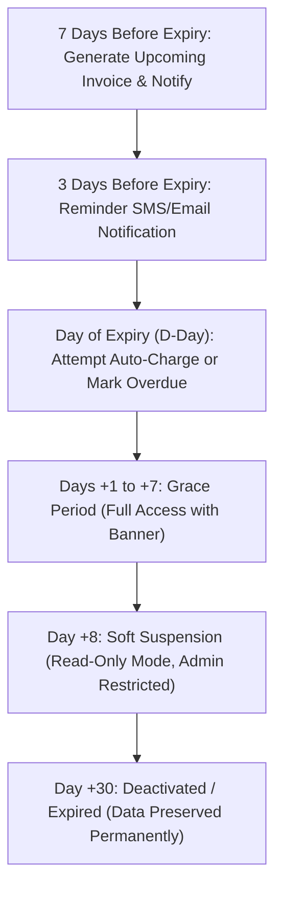

# RENEWAL_AUTOMATION.md — SaaS Subscription Automated Renewal & Dunning Engine

## 1. Automation Schedule & Cron Triggers
The platform runs scheduled Cloud Functions (or cron runners) daily at `00:15 Asia/Dhaka` to handle lifecycle transitions.

## 2. Notification Schedule (Dunning Management)
- **T-7 Days**: Invoices generated in `pending_payment` state; notification sent to Society President & Accountant.
- **T-3 Days**: Urgent reminder with 1-click bKash/Nagad checkout link.
- **T-0 Days**: If unpaid, state transitions to `renewal_due`.
- **T+1 to T+7 Days**: Grace period (`grace_period`). Society users can continue everyday operations with an informational warning banner.
- **T+8 Days**: State transitions to `suspended`. All writes blocked except Super Admin emergency bypass or payment completion.
- **T+30 Days**: State transitions to `expired`. **ZERO DATA DELETION**: All records remain intact in Firestore.
