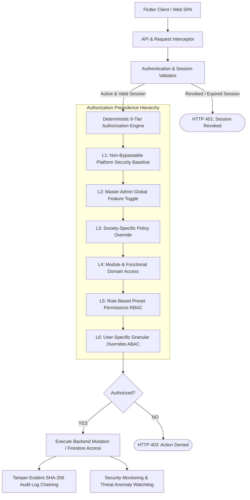

# PHASE 4: ENTERPRISE SECURITY ARCHITECTURE & POLICY SPECIFICATION

**Project:** Multi-Society Cooperative Management SaaS Platform  
**System:** Enterprise Security, Access Control & Compliance Engine  
**Version:** 4.0.0-security-hardened  
**Date:** 2026-11-14  

---

## 1. High-Level Architectural Diagram

---

## 2. Deterministic 6-Tier Authorization Hierarchy

A lower tier can **never** override a higher-tier security restriction.

1. **L1 — Non-Bypassable Platform Security Baseline**:
   - Mandatory server-side authentication.
   - Strict tenant isolation (`somitiId` boundary).
   - Invariant financial integrity ($\sum \text{Debit} == \sum \text{Credit}$).
   - Audit trail immutability.
   *Even Super Admin cannot configure a policy that breaks tenant data boundaries or injects unbalanced financial records.*

2. **L2 — Master Admin Global Feature Flags**:
   - Master switchboard disabling a whole functional domain platform-wide (e.g. `loan_management` or `payment_gateways`).
   - If disabled globally, all societies are restricted regardless of local preferences.

3. **L3 — Society-Specific Policy Overrides**:
   - Subscriptions and society custom boundaries (e.g., an urban society with automated MFS vs a rural cash-only society).

4. **L4 — Module & Functional Domain Access**:
   - Verification that the requesting user's tenant has licensed the active module.

5. **L5 — Role-Based Access Control (RBAC)**:
   - Evaluates standard role presets (`superAdmin`, `societyOwner`, `societyAdmin`, `manager`, `accountant`, `fieldOfficer`, `member`).

6. **L6 — Attribute & User-Level Overrides (ABAC)**:
   - Dynamic user-specific granting or restriction of individual actions based on contextual attributes (e.g., maximum disbursement limit $\le ৳৫০,০০০$, office IP subnet, working hours).

---

## 3. Cryptographic Audit Log Chaining (Tamper-Evidence)

To guarantee that audit records cannot be silently deleted or forged:
$$\text{Hash}_n = \text{SHA-256}(\text{Record}_n \,||\, \text{Hash}_{n-1})$$

Where $\text{Hash}_0$ is the genesis block hash (`"GENESIS_SOMITI_SECURITY_CHAIN_2026"`). If any intermediate record is tampered with, the chain checksum breaks immediately upon validation.

---

## 4. Session & Device Security Model

- **Session Registry**: Stored in `/security_sessions/{sessionId}`.
- **Attributes Tracked**: User UID, device name, browser/OS user-agent, IP address hash, login timestamp, last active timestamp, revocation status (`isRevoked`), expiration timestamp.
- **Immediate Invalidation**: When an admin clicks "Revoke Session" or "Force Logout All", `isRevoked` is set to `true`, and all subsequent API/database operations from that session are halted immediately.
