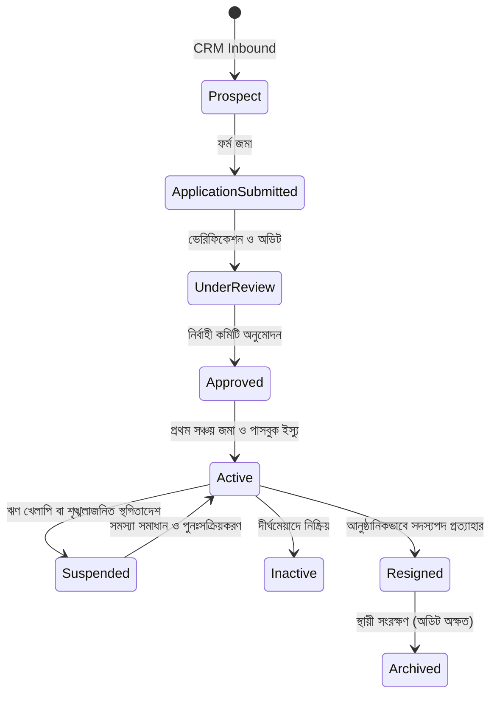

# MEMBER_LIFECYCLE.md — Member Lifecycle Management

## 1. Lifecycle State Machine
Integrates seamlessly with the existing `MemberModel` and membership registry:

## 2. Invariants
- Historical financial transactions (savings deposits, loan repayments) are **NEVER deleted** when a member resigns or becomes inactive.
- Status transitions require maker-checker approval and produce cryptographic audit logs.
