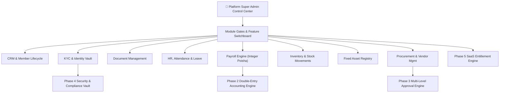

# PHASE_6_ARCHITECTURE.md — Enterprise Society Management Ecosystem Architecture

## 1. System Vision & Scope
Phase 6 expands the Multi-Society Cooperative Platform into a full-scale Enterprise Society Operations Ecosystem. It integrates:
- **CRM & Relationship Management**: Contact and prospective member pipelines with follow-ups.
- **Member Lifecycle Engine**: 8-state transition model from prospect to active, suspended, or archived.
- **Digital KYC & Identity Vault**: Verification workflows for NID, Passport, and Birth Certificates with strict privacy.
- **Enterprise Document Management**: Multi-category, encrypted storage paths, versioning, and download audit logs.
- **HR & Employee Management**: Organizational hierarchy, departments, designations, and onboarding.
- **Attendance & Leave Engine**: Check-in/check-out, correction approvals, and leave balance tracking.
- **Payroll Management**: Precision Integer Poisha money arithmetic, salary structures, deductions, and automatic journal vouchers mapped to the accounting engine.
- **Inventory Management**: Stock movements (opening, receiving, issue, adjustment), low-stock alerts, and concurrency safety.
- **Asset Management**: Fixed asset registry, depreciation tracking, maintenance logs, and disposal.
- **Procurement & Vendor Management**: Vendors, purchase requests, approval workflow integration, purchase orders, and goods receiving.
- **Operations & Task Management**: Internal operational tasks, assignees, deadlines, and escalations.

## 2. Universal Super Admin Control Center
Every single module, sub-feature, action button, toggle, and CRUD operation has a registered permission key. Super Admin has real-time ON/OFF switchboard overrides both platform-wide and per individual cooperative society.
