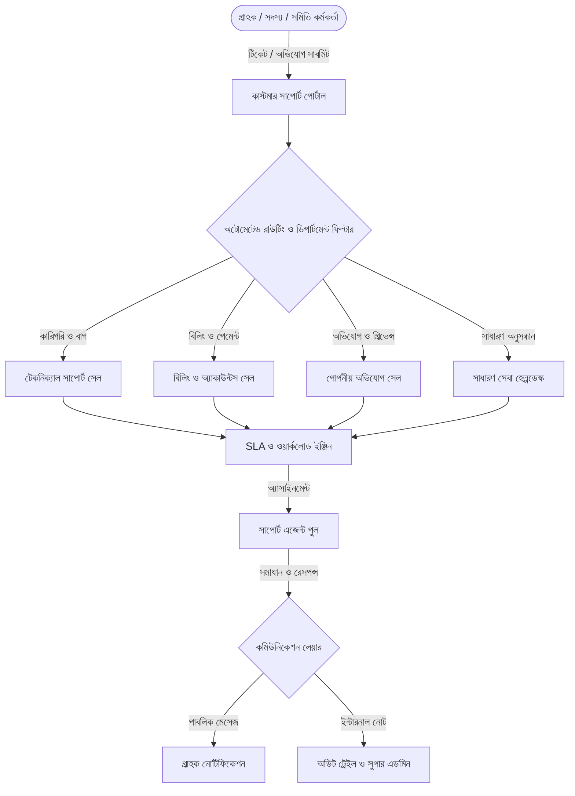
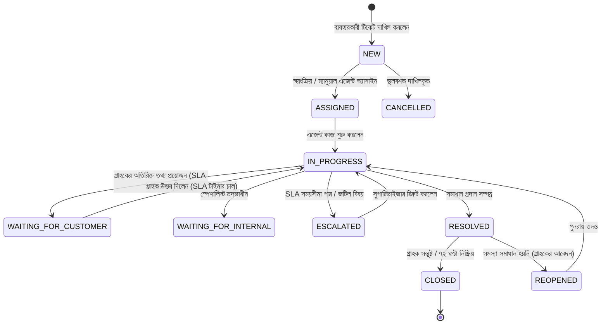

# PHASE 14 — ENTERPRISE CUSTOMER SUPPORT, HELPDESK & SERVICE MANAGEMENT ENGINE

## ১. ভূমিকা ও লক্ষ্য (Introduction & Objective)

"স্বপ্ন ছোঁয়া ঐক্য সমিতি" মাল্টি-টেন্যান্ট কো-অপারেটিভ SaaS প্ল্যাটফর্মের ফেজ ১৪-এর উদ্দেশ্য হলো একটি সেন্ট্রালাইজড, মাল্টি-টেন্যান্ট-অ্যাওয়ার, নিরাপদ ও উচ্চ ক্ষমতাসম্পন্ন কাস্টমার সাপোর্ট, হেল্পডেস্ক এবং সার্ভিস ম্যানেজমেন্ট ইকোসিস্টেম গড়ে তোলা। এর মাধ্যমে প্ল্যাটফর্ম সুপার এডমিন, সাপোর্ট টিম, সমিতি প্রশাসক, শাখা ব্যবস্থাপক, মাঠ কর্মকর্তা এবং সাধারণ সদস্যরা সম্পূর্ণ স্বচ্ছতা ও নিয়ন্ত্রণের সাথে সেবা গ্রহণ এবং সমস্যা সমাধান করতে পারবেন।

---

## ২. কোর সাপোর্ট আর্কিটেকচার (Core Architecture Pillars)

### প্রধান ফিচারসমূহ:
1. **মাল্টি-টিয়ার হেল্পডেস্ক:**
   - প্ল্যাটফর্ম-লেভেল সাপোর্ট (সুপার এডমিন বনাম সমিতি মালিক)
   - সমিতি-লেভেল সাপোর্ট (সমিতি এডমিন বনাম সাধারণ সদস্য/কর্মকর্তা)
2. **কঠোর ডেটা আইসোলেশন ও টেন্যান্ট সিকিউরিটি:**
   - কোনো সমিতি কর্মকর্তা অন্য সমিতির টিকেট বা ব্যক্তিগত অভিযোগ দেখতে পারবেন না।
   - প্ল্যাটফর্ম সাপোর্ট এজেন্ট কেবলমাত্র তাদের অনুমোদিত ডিপার্টমেন্ট ও স্কোপের টিকেট দেখতে পাবেন।
3. **ইন্টারনাল নোটস প্রোটেকশন:**
   - সাপোর্ট এজেন্টদের অভ্যন্তরীণ পরামর্শ ও তদন্ত নোট সাধারণ গ্রাহক/সদস্যের নিকট সম্পূর্ণ অদৃশ্য থাকবে।
4. **জিরো-ডেটা লস ও ইমিউটেবল রেকর্ডস:**
   - কোনো সাপোর্ট টিকেট বা অভিযোগ সরাসরি মুছে ফেলা (Hard Delete) নিষিদ্ধ। স্ট্যাটাস ট্রানজিশনের মাধ্যমে `CLOSED` বা `CANCELLED` করা হবে।

---

## ৩. টিকেট লাইফসাইকেল স্টেট মেশিন (Ticket Lifecycle State Machine)

---

## ৪. মাল্টি-টেন্যান্ট ডেটাবেজ স্কিমা (Firestore Collections)

1. **টেন্যান্ট-স্কোপড কালেকশনসমূহ (`/somitis/{somitiId}/...`):**
   - `support_tickets`: সমিতির অভ্যন্তরীণ টিকেট ও সমস্যা
   - `support_tickets/{ticketId}/messages`: কথোপকথন, গ্রাহক বার্তা ও ইন্টারনাল নোট
   - `support_complaints`: সদস্য ও স্টাফদের গোপনীয় অভিযোগ ও তদন্ত
   - `tenant_knowledge_articles`: সমিতির নিজস্ব অভ্যন্তরীণ নিয়মাবলী ও গাইড
2. **রুট / গ্লোবাল কালেকশনসমূহ (`/...`):**
   - `platform_support_tickets`: SaaS প্ল্যাটফর্মের কেন্দ্রীয় টিকেট (বিলিং, এপিআই, সার্ভার ইত্যাদি)
   - `support_departments`: টেকনিক্যাল, বিলিং, অপারেশনাল ও গ্রিভেন্স বিভাগ
   - `support_agents`: এজেন্টদের রোল, ওয়ার্কলোড লিমিট ও কার্যকারিতা
   - `support_sla_policies`: অগ্রাধিকারভিত্তিক ফার্স্ট রেসপন্স ও রেজোলিউশন এসএলএ
   - `support_knowledge_base`: সার্বজনীন এফএকিউ এবং টিউটোরিয়াল
   - `support_feedback`: সিএসএটি (CSAT) ও সন্তুষ্টি পর্যালোচনা
   - `support_audit_logs`: অপরিবর্তনীয় অডিট লগ

---

## ৫. সুপার এডমিন সার্বজনীন কন্ট্রোল ম্যাট্রিক্স

সুপার এডমিনের নিকট প্রতিটি মডিউল ও ফিচারের জন্য সেন্ট্রালাইজড অন/অফ কন্ট্রোল রয়েছে:
- গ্লোবাল হেল্পডেস্ক সক্রিয়/নিষ্ক্রিয়
- লাইভ চ্যাট এনাবল/ডিজেবল
- অটোমেটিক এজেন্ট অ্যাসাইনমেন্ট মেথড (ম্যানুয়াল / রাউন্ড-রবিন / ওয়ার্কলোড ব্যালেন্সড)
- এসএলএ ব্রিচ নোটিফিকেশন ইঞ্জিন
- গোপনীয় অভিযোগ সেল ও অ্যানোনিমাস রিপোর্টিং টগল
- নলেজ বেস সেলফ-সার্ভিস পোর্টাল
- গ্রাহক সন্তুষ্টি (CSAT) ফিডব্যাক ফর্ম
