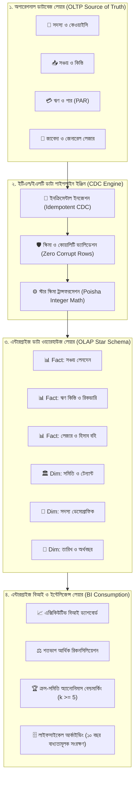

# PHASE 17: ENTERPRISE DATA WAREHOUSE & ADVANCED INTELLIGENCE ARCHITECTURE

## ১. ওভারভিউ ও আর্কিটেকচার নীতি (Overview & Core Tenets)
ফেজ ১৭-এর উদ্দেশ্য হলো "স্বপ্ন ছোঁয়া ঐক্য সমিতি" মাল্টি-টেন্যান্ট সমবায় প্ল্যাটফর্মে একটি উচ্চ ক্ষমতাসম্পন্ন, ঐতিহাসিক, নির্ভুল এবং ট্রানজেকশন-সুরক্ষিত **এন্টারপ্রাইজ ডাটা ওয়্যারহাউজ (EDW) ও বিজনেস ইন্টেলিজেন্স (BI) প্ল্যাটফর্ম** প্রতিষ্ঠা করা।

---

## ২. ওএলটিপি ও ওএলএপি পৃথকীকরণ (OLTP vs OLAP Separation)
- **অপারেশনাল ডাটাবেজ (Firestore OLTP):** গ্রাহকের দৈনন্দিন কিস্তি জমা, ঋণ উত্তোলন এবং ভাউচার পোস্টিংয়ের একক সত্যতার উৎস (Single Source of Truth)।
- **ডাটা ওয়্যারহাউজ লেয়ার (Analytical OLAP):** আলাদা ডিনর্মালাইজড স্টার স্কিমা (Star Schema), যা ভারী অ্যানালিটিক্যাল কোয়েরি ও হিস্টোরিক্যাল ট্রেন্ড অ্যানালাইসিস সম্পন্ন করে ট্রানজেকশনাল ডাটাবেজের পারফরম্যান্স ও ইনডেক্সিং অক্ষুণ্ণ রাখে।

---

## ৩. স্টার স্কিমা ফ্যাক্ট ও ডাইমেনশন ম্যাট্রিক্স (Star Schema Specifications)

| টেবিল / কালেকশন | ধরন | বিবরণ ও গ্র্যানুলারিটি | প্রধান কী ও মেজার্স |
|:---|:---:|:---|:---|
| `fact_savings_transactions` | Fact | প্রতিটি সঞ্চয় জমা ও উত্তোলনের গ্র্যানুলার রেকর্ড | `txId`, `societyId`, `memberId`, `amountInPoisha`, `balanceInPoisha` |
| `fact_loan_installments` | Fact | প্রতিটি ঋণ কিস্তি আদায়, আসল, লাভ ও জরিমানা | `installmentId`, `principalPoisha`, `interestPoisha`, `parCategory` |
| `fact_journal_entries` | Fact | ডাবল-এন্ট্রি জাবেদার প্রতিটি ডেবিট/ক্রেডিট লাইন | `journalId`, `coaCode`, `debitPoisha`, `creditPoisha`, `fiscalYear` |
| `fact_daily_cashbook` | Fact | প্রতিদিনের প্রারম্ভিক, মোট জমা, মোট খরচ ও সমাপনী | `date`, `societyId`, `totalReceipts`, `totalPayments`, `closingBalance` |
| `dim_societies` | Dimension | সমিতির প্রোফাইল, সাবস্ক্রিপশন ও আঞ্চলিক তথ্য | `societyId`, `nameBn`, `district`, `planTier` |
| `dim_members` | Dimension | সদস্যের ক্যাটাগরি, ভর্তির তারিখ ও ঝুঁকি স্কোর | `memberId`, `societyId`, `occupation`, `riskRating` |
| `dim_date` | Dimension | বাংলা ও ইংরেজি ক্যালেন্ডার, অর্থবছর ও কোয়ার্টার | `dateKey`, `fiscalYear`, `quarter`, `monthBn` |

---

## ৪. পাইপলাইন ফেইলিউর রিকভারি ও আইডেমপোটেন্সি (Idempotent Ingestion)
- **চেকপয়েন্টিং:** প্রতিটি ইটিএল পাইপলাইন রান শেষে শেষ সফল ট্রানজেকশনের টাইমস্ট্যাম্প (`checkpointTimestamp`) স্টোর করে।
- **স্বয়ংক্রিয় রিট্রাই ও ব্যাকঅফ:** নেটওয়ার্ক বা মেমোরি ফেইলিউর হলে এক্সপোনেনশিয়াল ব্যাকঅফ (১ম রিট্রাই: ৩০ সেকেন্ড, ২য়: ২ মিনিট, ৩য়: ১০ মিনিট) সহ রিট্রাই হয়।
- **আইডেমপোটেন্সি:** একই ডাটা পুনরায় প্রসেস হলেও প্রাইমারি ক্রিপ্টোগ্রাফিক কি ব্যবহার করে ডুপ্লিকেট এন্ট্রি প্রতিরোধ করা হয়।
