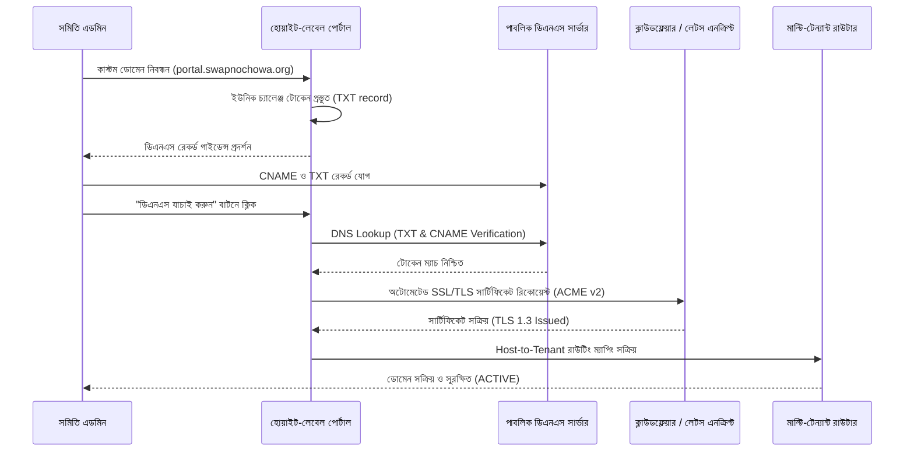

# CUSTOM DOMAIN & DNS VERIFICATION SPECIFICATION

## ১. ওভারভিউ ও প্রোটোকল
প্ল্যাটফর্ম প্রতিটি এন্টারপ্রাইজ সমিতিকে নিজস্ব ব্র্যান্ডেড ওয়েব পোর্টাল চালানোর জন্য কাস্টম ডোমেন (যেমন: `portal.swapnochowa.org`) অথবা ডেডিকেটেড সাবডোমেন (যেমন: `swapnochowa.somiti.app`) ব্যবহারের সুযোগ দেয়।

---

## ২. ডোমেন মালিকানা যাচাইকরণ ফ্লো (Verification Lifecycle)

---

## ৩. ডিএনএস কনফিগারেশন রিকোয়ারমেন্টস

| রেকর্ড টাইপ | হোস্ট / নাম | টার্গেট ভ্যালু | উদ্দেশ্য |
|:---|:---|:---|:---|
| **CNAME** | `portal` (বা আপনার সাবডোমেন) | `custom.somiti.app` | ট্রাফিককে এন্টারপ্রাইজ ক্লাউড গেটওয়েতে রাউট করা |
| **TXT** | `_somiti-challenge.portal` | `somiti-verify=v=1;t=9a8f4c120e` | ডোমেনের বৈধ মালিকানা যাচাই ও সাবডোমেন টেকওভার প্রতিরোধ |

---

## ৪. অ্যান্টি-টেকওভার ও হোস্ট ইনজেকশন নিরাপত্তা নীতি

1. **Host-to-Tenant কঠোর ম্যাপিং:** প্রতিটি ইনকামিং HTTP রিকোয়েস্টের `Host` হেডার ডাটাবেজে ভেরিফাইড টেন্যান্টের সাথে মিলিয়ে দেখা হয়। অমিল হলে তাৎক্ষণিক `HTTP 404 Host Not Found` প্রদর্শিত হয়।
2. **সার্টিফিকেট অটো-রিনিউয়াল:** TLS 1.3 এনক্রিপশন স্বয়ংক্রিয়ভাবে প্রতি ৬০ দিনে রিনিউ হয়।
3. **এইচএসটিএস (HSTS) সুরক্ষা:** `Strict-Transport-Security: max-age=31536000; includeSubDomains; preload` বাধ্যতামূলক।
